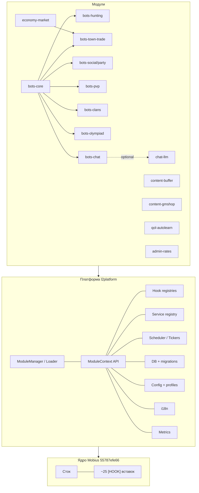
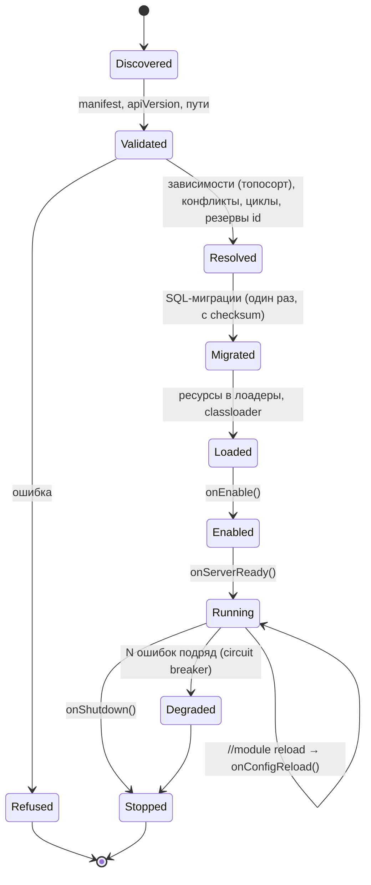
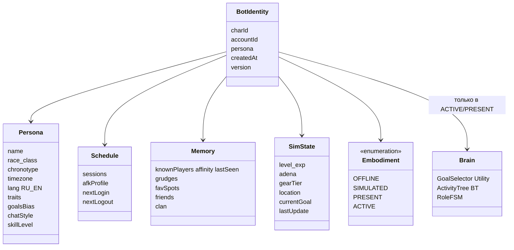
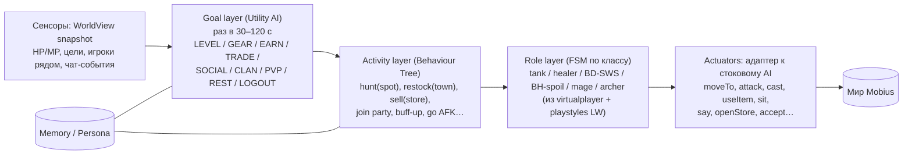
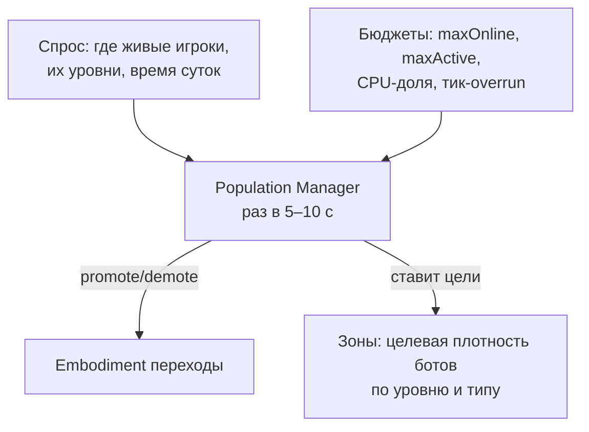
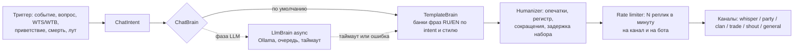
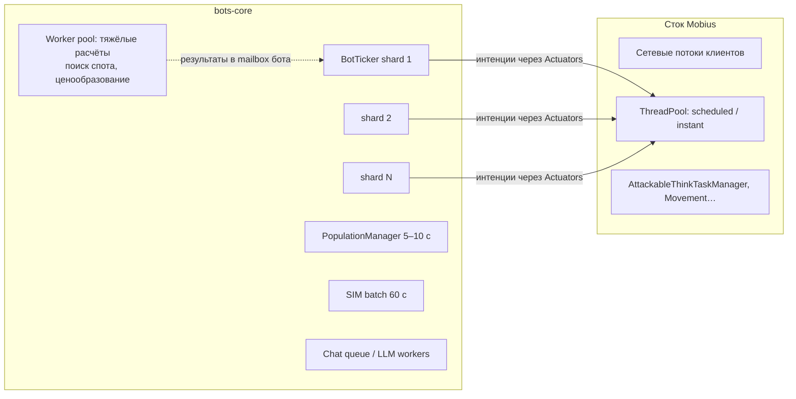

# Новая сборка L2 Interlude: архитектура (этап 0, только проектирование)

*Дата: 10 октября 2026 (MSK). Источники: чистый Mobius `F:\L2J_Mobius_Interlude_v1`, твой сервер `E:\L2J_Mobius_CT_0_Interlude`, форк L2-Living-Worlds (LW) и upstream Mobius (клоны на боксе). На твоём ПК ничего не менялось, только чтение.*

**Условные обозначения.** ✅ **Факт**: проверено по коду или файлам. 💡 **Предложение**: решение, которое я предлагаю. 📏 **Оценка**: прикидка, её нужно подтвердить нагрузочным тестом.

> **Обновление 10.10.2026 (13:40 MSK): база сменилась.** Теперь основа — `F:\L2J_Mobius_Interlude_v10.10.26`. ✅ Это ровно upstream **`9fb01cb205`** (master Mobius, 2026-10-10 07:11 MSK, «Raid boss spawn locations corrected…»): совпали git-blob-хеши всех 19 144 файлов. Главное отличие от `55787efe66`: **требуется Java 27** (`build.xml`: `JDK27.present`, source/target 27, Ant ≥ 1.9.10). Пакеты и `EventType` не менялись. Хук-лист ниже остаётся в силе, поправки в разделе 5.2 и в `/workspace/phase0_plan.md`. Где ниже упоминается `55787efe66` как база, читать `9fb01cb205`.

**Что уже решено (ответы Глеба):**
- Одна сборка для двух режимов: **онлайн** (VPS) и **одиночная игра** (локальный Docker).
- Цель по нагрузке: **1000 ботов + 500 живых игроков одновременно**.
- Рейты просто настраиваются в конфиге, отдельно их не проектируем.
- **LLM локальная** (Ollama или похожая) и подключается **последней фазой**. Шаблонный чат должен полностью работать без неё.

---

## 0. Коротко

| Вопрос | Решение |
|---|---|
| База | ✅ Чистый Mobius CT_0 Interlude, **Release August 15th 2026** (`55787efe66`). Это та же ревизия, что и у твоего сервера: пакеты `entity`/`mechanics`, Java 25, Ant. |
| Ядро | 💡 Сток плюс **тонкий слой «platform hooks»**: около 25 точечных вставок по 1–5 строк, все помечены `// [HOOK:id]`. Никакой логики фич в стоковых классах. |
| Расширения | 💡 Модульная система на основе фреймворка LW, но переделанная: manifest с версиями, компилируемые модули (jar) плюс скриптовые, версионированные SQL-миграции, профили `online`/`solo`, сервис-реестр. |
| Боты | 💡 **Одна** подсистема «Living Players» вместо 4–5 параллельных (virtualplayer, pvpbots, FakePlayerStore, фантомы LW, town FPC LW). Каждый бот — настоящий персонаж в БД с персоной, расписанием и памятью. |
| Мозг бота | 💡 Три уровня: Utility AI выбирает цель → Behaviour Tree выполняет занятие → FSM роли ведёт бой. Действия идут через тонкий адаптер к стоковому AI. |
| Масштаб | 💡 LOD по 4 уровням (OFFLINE → SIMULATED → PRESENT → ACTIVE), шардированный тикер с бюджетом времени, деградация при перегрузе. |
| Чат | 💡 Шаблоны + «очеловечивание» работают сами по себе. LLM подключается позже как асинхронный `ChatBrain` с fallback на шаблоны. |
| Апгрейд Mobius | 💡 Ветка-вендор `upstream/mobius` + `main` с хуками. Обновление = импорт нового релиза Mobius и merge; конфликты только в строках `[HOOK]`. |

---

## 1. Исходные данные (проверено)

### 1.1 Чистый Mobius `F:\L2J_Mobius_Interlude_v1`

| Параметр | Значение |
|---|---|
| Проект | ✅ `L2J_Mobius_CT_0_Interlude` (имя в `build.xml`) |
| Ревизия | ✅ **`55787efe66` «Release: August 15th 2026»** (2026-08-15 00:46 MSK). Число файлов совпало с upstream (1617 java в `java/`, 866 java в `dist/game/data/scripts`), git-blob-хеши `GameServer.java` и `Player.java` совпали байт в байт с этим коммитом. |
| Отставание от upstream | ✅ После релиза в upstream есть ещё **56 коммитов** по CT_0, последний `aef47e5c4c` от 2026-10-09. |
| Пакеты | ✅ Новая раскладка: `gameserver.{ai, cache, communitybbs, config, data, entity, geoengine, handler, interfaces, managers, mechanics, network, scripting, taskmanagers, ui, util}`. Это раскладка **твоего** сервера, а не старая `model.*` из LW. |
| Java / сборка | ✅ Java 25 (`.classpath` JavaSE-25, `build.xml` source/target 25, проверка `JDK25.present`). Ant собирает `LoginServer.jar`, `GameServer.jar`, `DatabaseInstaller.jar` в `../build`. На ПК стоит OpenJDK 25+37-LTS. |
| Библиотеки | ✅ HikariCP 7.0.2, mysql-connector-j 9.5.0, slf4j 2.0.17. Тестового фреймворка нет. |
| git | ✅ Нет ни в `F:\...`, ни в `E:\L2J_Mobius_CT_0_Interlude` (папки `.git` нет). |
| Дефолты | ✅ `AutoCreateAccounts = True` (login `Server.ini:77`), `EnableAutoPlay = False`, `EnableFakePlayers = False`, `EnableOfflinePlayCommand = False`. |
| Папка `launcher` | ✅ Пустая. |

### 1.2 Твой сервер `E:\L2J_Mobius_CT_0_Interlude` против чистого

✅ Та же ревизия **плюс 115 новых java-файлов** (`virtualplayer/` 99 файлов, `pvpbots/` 9, конфиги `PvpBotsConfig`/`VirtualPlayersConfig`, `FakePlayerStore*` 4, `VoicedCommandUtil`). По размеру отличаются **18 стоковых java**: `GameServer`, `Shutdown`, `ConfigLoader`, `PlayerConfig`, `CaptchaConfig`, `SchemeBufferConfig`, `World`, `Player`, `SchemeBuffer`, `PlayerStatus`, `PlayerInventory`, `CaptchaManager`, `RequestJoinParty`, `RequestPrivateStoreBuy/Sell`, `Say2`, `PrivateStoreListBuy/Sell`.
*(Сравнивал только размеры, поэтому правки без изменения размера, например `SkillTreeData` из CUSTOM_CHANGES, могли не попасть в список. Скрипты datapack: `NpcClick`, `MasterHandler` не сравнивал.)*

Наблюдения:
- ✅ Боты обоих видов (`VirtualPlayerFactory`, `PvpBotFactory`) — это настоящие `Player` из `Player.create(...)`, без клиента, на стоковом механизме `setOfflinePlay(true)` / `setOnlineStatus(true)`. Тик идёт пулом через `ThreadPool.schedulePriorityTaskAtFixedRate(new ThinkTask(pool))`. Это тот же паттерн, что у стокового `AutoPlayTaskManager`.
- ✅ Хуки pvpbots в `Player` (`isAutoAttackable`, `checkPvpSkill`, проверка аккаунта `pvp_bots`), FakePlayerStore в `Player.doInteract`.
- ⚠️ Код `virtualplayer` по стилю похож на **декомпилированный** (явные приведения `(PlayerTemplate)template`, `this.` везде). Это наблюдение, а не факт. Важно для лицензии: см. открытые вопросы.

### 1.3 Точки расширения в стоковом Mobius (✅ всё есть в `55787efe66`)

| Механизм | Где | Что даёт |
|---|---|---|
| События | `mechanics/events/{EventDispatcher, EventType, Containers, ListenersContainer}`, holders `On*` (85 файлов) | ~85 типов, в т.ч. `ON_PLAYER_LOGIN/LOGOUT`, `ON_PLAYER_CHAT` (с `ChatFilterReturn`, можно фильтровать), `ON_CREATURE_DEATH/KILLED/DAMAGE_*`, `ON_CREATURE_ZONE_ENTER/EXIT`, `ON_PLAYER_LEVEL_CHANGED`, `ON_PLAYER_ITEM_*`, `ON_PLAYER_CLAN_*`, `ON_OLYMPIAD_MATCH_RESULT`, `ON_SERVER_START`, `ON_DAY_NIGHT_CHANGE`, `ON_DAILY_RESET`. Контейнеры `Global/Players/Npcs/Monsters`; `notifyEventAsync`. **Нет**: событий пати, трейда, private store, заявок (invite/duel/friend). |
| Хендлеры | `handler/*Handler` | admin, voiced, user, bypass, chat, item, effect, target, action click/shift, community board, punishment. `registerHandler(...)` в рантайме. |
| Скрипты | `scripting/ScriptEngine` + `ScriptExecutor` + `ScriptClassLoader` | Компиляция `dist/game/data/scripts` при старте, исключения через `Scripts.xml`. |
| Потоки | `commons/threads/ThreadPool` | high-priority scheduled, scheduled и instant пулы (`Threads.ini`, `-1` = авто). |
| AutoPlay/AutoUse | `taskmanagers/AutoPlayTaskManager` | Пулы по 200 игроков, тик 700 мс (`POOL_SIZE`, `TASK_DELAY`). |
| Offline play / offline trade | `Player.isOfflinePlay/setOfflinePlay`, `OfflinePlayTable`, `OfflineTrade.ini` | Стоковый `Player` без клиента, на котором держатся все боты. |
| Fake players (NPC) | `FakePlayerData`, `FakePlayerInfo`, `FakePlayerChatManager`, `custom/FakePlayers` | NPC, который выглядит как игрок. Дёшево, но это не `Player`. |
| Конфиги | `config/ConfigLoader` + ~60 `*Config` | ini-файлы. Модульных конфигов нет. |
| Мультиязычность | `MultilingualSupport.ini` | язык игрока для html. |

### 1.4 Living Worlds

✅ Основан на старом Mobius (`9139183ba9`, 2026-06-18, раскладка `model.*`). Между ним и Release 15.08 **692 файла переименованы**, поэтому код LW переносится только вручную. Подробности в `/workspace/living_worlds_analysis.md`.

---

## 2. Модульный фреймворк LW: оценка

✅ Факты: `gameserver/modules/*` (22 файла, ~3,2 тыс. строк), документы `MODULE_FRAMEWORK.md` и `MODULE_AUTHORING_GUIDE.md`. Модуль — это папка `game/modules/<id>/` с `module.json`, `config/module.ini` (флаг включения), `scripts/` (компилируются в рантайме через `ScriptEngine.compileModuleScripts`, пакет `modules.<id>`), `data/`, `sql/`. Порядок: discover → validate (id, apiVersion, deps/conflicts/циклы, пути) → index stock ids → проверка резервов id → load resources → `onEnable(ModuleContext)`. Включение и выключение только с рестартом. Регистрации привязаны к модулю (`ModuleHandles`).

**Что хорошо, берём:**
1. Главное правило: «ядро даёт возможности, модули дают фичи». Модуль не правит стоковые классы, а если нужна новая точка, в платформу добавляется один **общий** хук.
2. Модуль — одна папка: установка и удаление безопасны, пути в manifest проверяются (без `..`).
3. **Generic behaviour hooks** с явными правилами композиции (multiplier / first result / transform / cancellable / notification) и детерминированным порядком (priority, затем id).
4. **Резервирование диапазонов id** (items/skills/npcs) и проверка на коллизии со стоком и другими модулями.
5. Отслеживание владельца каждой регистрации (listener/handler/task), что даёт диагностику и задел под выгрузку.
6. БД: модуль никогда сам не удаляет таблицы, удаление — отдельное явное действие.
7. Ресурсные корни модулей в лоадерах (Item/Skill/Npc/Multisell/Spawn), вкладки Community Board.
8. Тесты на manifest/validator/Json.

**Что меняем (💡):**

| Проблема в LW (✅ факт) | Решение |
|---|---|
| В `ModuleContext` зашиты бот-сервисы `companions()` и `encounters()` (это фантомы LW). Платформа зависит от конкретной фичи. | Платформа знает только общие сервисы. Боты — это модуль `bots-core`, который **публикует** свой API через сервис-реестр (`ctx.services().provide(BotService.class, ...)`), а остальные модули объявляют зависимость. |
| Только скрипты, компилируемые в рантайме. Большой код (десятки тысяч строк) так неудобно писать, рефакторить и тестировать. | **Два вида модулей:** `compiled` (jar, собирается Ant/Gradle с юнит-тестами, грузится своим classloader) для больших систем и `script` (исходники, стоковый ScriptEngine) для мелочей и контента. |
| Зависимости только по id, версии не проверяются. | Semver: `"dependencies": {"bots-core": "^1.2"}`, `apiVersion: "^1.0"`, опциональные зависимости. |
| SQL `install.sql` выполняется при каждом включении (должен быть идемпотентным). | Версионированные миграции `sql/V001__init.sql`, `V002__...` плюс таблица `module_schema_history(module, version, checksum, applied_at)`. Каждая миграция выполняется один раз. |
| Флаг включения лежит внутри `module.ini` каждого модуля. | Центральный `config/modules.ini` (`bots-core = on`) с **профилями** `online`/`solo` и переопределением через переменные окружения (для Docker). Конфиг модуля: дефолты в модуле, переопределения в `config/modules/<id>.ini`, так что обновление модуля не затирает настройки. |
| Hot-unload не реализован, и это честно. | Оставляем рестарт для кода. **Горячая перезагрузка конфигов и данных**: `//module reload <id>` → `onConfigReload()`. |
| Нет изоляции ошибок. | Исключения в listener/tick модуля ловятся и считаются; после N ошибок подряд модуль переводится в `DEGRADED` (circuit breaker), сервер продолжает работать. |
| Ошибки выявляются только при старте. | Плюс `--validate-modules` (dry-run в CI). |
| HTML модулей не подключён. | Корень `data/html` модуля в `HtmCache` (хук) + i18n-ключи. |

Вердикт: **берём концепцию, manifest, валидатор, резервирование id, generic hooks и ownership tracking как основу (M)**. Переписываем под новую раскладку пакетов и под требования выше. Бот-сервисы из платформы выносим.

---

## 3. Инвентарь фич: что берём

Вердикты: **Взять** — перенести почти как есть (под новые пакеты). **Переписать** — взять идеи, данные или алгоритмы, а код написать заново в новой архитектуре. **Конфиг** — это стоковая настройка, кода не нужно. **Отказаться**.

### 3.1 Боты

| Фича | Источник (✅) | Вердикт (💡) | Почему |
|---|---|---|---|
| Пати-боты по ролям (Tank/BD/BH/Mage/Healer/Support/TownBuffer), FSM ролей, бой, спойл, танцы, PvP-защита, уклонение от рейдов | твой `virtualplayer/` (99 файлов: `role/`, `fsm/states/{bd,bh,mg,tk,tb}`, `systems/Virtual*Combat`, `VirtualSkillController` 514 стр.) | **Переписать**, логику ролей взять за основу **боевого уровня** | Структура (brain/blackboard/memory/fsm/roles) ближе всего к целевой. Но проверить лицензию Bot_interlude; общий аккаунт `virtual_players`. |
| PvP-боты в фарм-зонах (событие, грейд экипировки по paperdoll, отступление при HP ≤ 30 %, clamp урона) | твой `pvpbots/` (9 файлов, ~2,2 тыс. стр.), хуки в `Player`, `PlayerStatus.reduceHp` | **Переписать** в модуль `bots-pvp` (encounters) | Объединить с PvP LW. `PvpBotGear` (подбор по грейду) взять почти как есть. |
| Торговцы Гирана (20 шт.) + 4UDO (сосок, бесконечный сток) | твои `FakePlayerStore*`, `FakePlayerStores.xml`, `fpc_giran_traders.xml`, хуки `NpcClick`/`Player.doInteract`/`RequestPrivateStore*` | **Переписать**: торговцы становятся ботами-`Player` в стоковом private store | Тогда не нужны хуки в пакетах лавок: окно, покупка и продажа полностью стоковые. Ассортимент XML переходит в персоны торговцев. |
| Фантомы-охотники в поле (активация рядом с игроком, 844 зоны / 1120 слотов, playstyles по классам, weapon sets, баффы, skill fallback, позиционирование кастеров) | LW `PhantomManager` (8 097 стр.) + `PhantomPlaystyle*`, `PhantomPopulations.xml`, `PhantomPlaystyles.xml` | **Переписать**. **Данные** (зоны, playstyles) импортировать, чистые хелперы (SkillFallback, CasterPositioning, Combat*) перенести с тестами | god-класс, старая раскладка, бой через стоковый AutoPlay с исключениями. |
| Рекрут-пати («Looking for Party»), команды в пати-чате, downtime | LW `PhantomPartyManager` (8 417 стр.), `PartyCommandRules`, `PartyDowntime` | **Переписать**, правила (`PartyCommandRules`, `PartyDowntime` — чистые, с тестами) **взять** | Ляжет на социальный уровень бота. |
| Buddy (личный бот-напарник) | LW `PhantomBuddyManager` (1 905) | **Переписать** как роль «companion» обычного бота | |
| Town FPC (989 NPC-«игроков», FSM, маршруты, внешность, лавки) | LW `FakePlayerBehaviorManager` и др. (~6,9 тыс.), `FakePlayerBehavior.xml` | **Переписать**. Взять `FakePlayerAppearanceFactory`, `NameFactory`, `RouteData`/`RouteRecorder`, `GrudgeRules` | В новой модели городская жизнь — это занятие обычного бота. NPC-fake остаётся только как дешёвая «массовка» (опционально). |
| WTS/WTB в торговом чате | LW `FakePlayerChatParsing` (1 237, с тестами), `docs/WTS_WTB_TRADE_CHAT.md` | **Взять** парсер, обвязку **переписать** | Чистый код, покрыт тестами. |
| Трейд-события `ON_PLAYER_TRADE_*` | LW (~245 стр.) | **Взять** как platform hook | Нужны для рынка и для ботов. |
| Бот-кланы (гербы, состав) | LW `BotClanManager` (431) + `BotClans.xml` | **Взять с адаптацией** (M) | |
| Олимпиада ботов | LW `PhantomOlympiadManager` (625) + `OlympiadRules` | **Переписать** (поздняя фаза), `OlympiadRules` взять | |
| PvP фантомов (агрессоры, реакция на ПК, дуэли, кайт) | LW `PhantomPvpManager` (532), `PhantomEncounterRules` | **Переписать** вместе с pvpbots | Модуль encounters в LW утерян. |
| LLM-чат | LW `FakePlayerChatManager` (+3,4 тыс.), `BrainExecutor`, `fpc_brain.py` | **Последняя фаза.** Паттерн `BrainExecutor` (ограниченная очередь, сброс устаревших запросов) **взять**; клиент **переписать** под Ollama, URL в конфиг | В LW URL захардкожен `127.0.0.1:5000`. |
| Квест-кредит хозяину, исключение ботов из XP/лута в пати | LW `Attackable.resolveQuestKillCredit`, `Party.isLootEligible` | **Взять** как policy-хуки | |
| Captcha skip, игнор веса для ботов | твои правки `CaptchaManager`, `PlayerInventory` (LW тоже) | **Взять** через `isBot()`-хук | |
| Discord presence | LW | **Отказаться** (опционально позже) | |
| Лаунчер LW (C#/PS), l2admin | LW `dist/launcher*`, `tools/l2admin` | **Отказаться** | У тебя свой лаунчер 1.3.0. Идею редактора маршрутов можно взять потом. |
| `.alt` Alt Companion | LW модуль | **Отказаться** в текущем виде | Дыра: не проверяет владельца. |
| GM за аккаунт `admin` | LW `EnterWorld` | **Отказаться** | Бэкдор. |

### 3.2 Геймплейные кастомы

| Фича | Источник (✅) | Вердикт (💡) |
|---|---|---|
| Scheme Buffer (NPC 50008 в 15 городах, баффы 1 ч) | стоковый `SchemeBuffer` + твои правки + спавны | **Модуль** `content-buffer` (спавны, html, конфиг). Правку `SchemeBuffer.java` перенести как хук или вернуть в сток. |
| GM Shop (NPC 50010, мультиселлы) | твой datapack | **Модуль** `content-gmshop` (только данные). |
| Стартовая экипировка | `initialEquipment.xml` | **Модуль** с override данных или профиль. |
| Автоизучение скиллов до 75 ур. | `Player.ini` + твоя правка `SkillTreeData`/`PlayerConfig` (`AutoLearnSkillsMaxLevel`) | **Модуль** `qol-autolearn` + небольшой хук фильтра. |
| Бесплатная 1-я/2-я профа (popup) | `ClassMaster.xml` | **Конфиг** (профиль). |
| Чемпионы, автолут, адена x10, катакомбы без 7S, вес x5 | стоковые `ChampionMonsters.ini`, `Player.ini`, `Rates.ini`, `Feature.ini` | **Конфиг** (профили `online`/`solo`). |
| Rebirth | стоковый `Rebirth.ini` | **Конфиг**. |
| Seven Signs без расписания + соло-панель | LW `SevenSigns` +83, `SignsPriest` +82 | **Модуль** `qol-sevensigns-solo` + хук (по умолчанию только в `solo`). |
| Раздельные лимиты баффов (20) и песен/танцев (12) | LW `EffectList` | **Хук** + модуль `balance-bufflimits` (выключен по умолчанию). |
| Фиксы стражи (FPC-127/128), CursedWeapon, RequestBuyItem | LW | **Core fixes**. Отдельная ветка `fixes/*`, отправить в upstream Mobius. |
| `//rates` (AdminRates + rates.htm) | LW | **Модуль** `admin-rates`. |
| Рейды ×0,75, недельная олимпиада | LW конфиги | **Конфиг** профиля `solo`. |

---

## 4. Принципы

1. **Сток неприкосновенен.** В стоковых классах только хуки `[HOOK:id]` (1–5 строк, без логики фич) и багфиксы, которые можно отправить в upstream. Вся логика в платформе и модулях.
2. **Хуки инертны.** Пока никто не подписан, поведение байт в байт стоковое (проверяется тестом «все модули выключены»).
3. **Обновляемость.** Новый релиз Mobius должен вливаться за 1–2 дня: конфликты только в местах `[HOOK]`, список которых ведётся в `PLATFORM_HOOKS.md` и проверяется в CI.
4. **Одна система ботов.** Никаких параллельных менеджеров с разными аккаунтами и флагами. Один `isBot()`.
5. **Бот — честный игрок для движка.** Бот — это стоковый `Player`. Он ходит, бьёт, торгует и вступает в пати через те же механики, что и человек, а не через «фейковые» обходы. Меньше исключений — меньше багов.
6. **Бюджет прежде всего.** Каждый бот-тик учитывается. При перегрузе система сама снижает детализацию, а не тормозит сервер.
7. **Профили.** Одна сборка, два профиля: `online` (безопасные дефолты) и `solo` (удобные дефолты).
8. **Без LLM всё работает.** LLM — необязательное улучшение текста, а не источник решений.

---

## 5. Слои



- **Ядро.** Стоковый Mobius плюс вставки `[HOOK]`, каждая вызывает `PlatformHooks.xxx(...)`, а та возвращает нейтральное значение, пока никто не подписан.
- **Платформа** (`org.l2jmobius.platform`, внутри `GameServer.jar`). Загрузчик модулей, API, реестры хуков. Без игровых фич.
- **Модули** (`modules/<id>/`). Все фичи.

### 5.1 Список platform hooks (💡; классы ✅ существуют в `55787efe66`)

**A. Инициализация и жизненный цикл**

| # | Класс | Хук |
|---|---|---|
| H1 | `GameServer` | `Platform.init()` после загрузки данных и скриптов; `Platform.onServerReady()` после открытия сети. |
| H2 | `Shutdown` | `Platform.shutdown()` до сохранения игроков (модули сохраняют ботов и состояние). |
| H3 | `ScriptEngine` | компиляция `script`-модулей из `modules/<id>/scripts` (как в LW). |
| H4 | `ItemData`, `SkillData`, `NpcData`, `MultisellData`, `SpawnData`, `BuyListData`, `HtmCache` | дополнительные корни ресурсов модулей (как в LW, плюс HTML и buylist). |
| H5 | `CommunityBoardHandler` | вкладки модулей `%moduleTabs%` (как в LW). |

**B. Новые события** (`EventType` + holders, так их можно слушать стандартно)

| # | Событие | Где вызывается |
|---|---|---|
| H6 | `ON_PLAYER_PARTY_JOIN / LEAVE` | `Party.addPartyMember / removePartyMember` |
| H7 | `ON_PLAYER_TRADE_START / CANCEL / FINISH` | `Player.onTradeStart/Cancel/Finish`, `TradeList` (как в LW) |
| H8 | `ON_PLAYER_PRIVATE_STORE_BUY / SELL` (сделка в лавке) | `RequestPrivateStoreBuy/Sell` или `TradeList.privateStoreBuy/Sell` |
| H9 | `ON_PLAYER_STORE_OPEN / CLOSE` | `Player.setPrivateStoreType` |

**C. Заявки к игроку без клиента** (один общий хук вместо правок в каждом пакете)

| # | Класс | Хук |
|---|---|---|
| H10 | `RequestJoinParty`, `TradeRequest`, `RequestJoinPledge`, `RequestDuelStart`, `RequestFriendInvite`, `RequestJoinAlly` | если у цели нет клиента: `PlatformHooks.clientlessRequest(target, requester, RequestType)` → `ACCEPT / DECLINE / DEFER / NOT_HANDLED`. |
| H11 | `Player.sendPacket` (ветка без клиента) | `ClientlessPacketSink`: бот получает **семантические** события (личное сообщение, приглашение, ответ на трейд) без парсинга пакетов. Только для ботов, только whitelist пакетов. |

**D. Policy-хуки** (возвращают значение; правила композиции как в LW)

| # | Класс / метод | Хук | Кто использует |
|---|---|---|---|
| H12 | `Player.isAutoAttackable`, `Player.checkPvpSkill` | `CombatPolicy.allowAttack(attacker, target)` (cancellable/first) | PvP-события (pvpbots, encounters LW) |
| H13 | `PlayerStatus.reduceHp` / `Creature.reduceCurrentHp` | `DamagePolicy` (transform) + уведомление `ModuleDamage` | clamp урона PvP-ботов, DPS-метры |
| H14 | `Party` (распределение XP/SP, лут/адена) | `PartyRewardPolicy.isEligible(member)` | исключение ботов из XP и лута (настраиваемо) |
| H15 | `Attackable` (квестовый килл) | `QuestCreditPolicy.redirect(killer)` | кредит хозяину |
| H16 | `PlayerInventory` (вес) | `InventoryPolicy.ignoreWeight(player)` | боты |
| H17 | `CaptchaManager` | `CaptchaPolicy.exempt(player)` | боты |
| H18 | `EffectList` | `BuffLimitPolicy` (multiplier/override по типу эффекта) | модуль раздельных лимитов |
| H19 | `SkillTreeData` (автоизучение) | `SkillLearnPolicy` (фильтр) | `qol-autolearn` |
| H20 | `SevenSigns`, `SignsPriest` | `SevenSignsSchedulePolicy` | `qol-sevensigns-solo` |
| H21 | `World` / счётчики онлайна, `AttackableAI` (агр) | `PresencePolicy.isRealPlayer(player)`, `AggroPolicy` | онлайн-статистика, поведение мобов к ботам |

**E. Идентификация бота**

| # | Класс | Хук |
|---|---|---|
| H22 | `Player` | одно поле `BotHandle _bot` + `isBot()` / `getBot()`. Заменяет `isBuddyBot`, проверки аккаунтов `pvp_bots`/`virtual_players`/`phantom*`. |
| H23 | `LoginController` (login) | отказ во входе на бот-аккаунты (см. §11). |

Итого 💡 **~23 хука в ~35 стоковых файлах, ~200–300 строк**. Для сравнения: у LW +5 тыс. строк в 172 стоковых файлах, у тебя 18+ файлов с логикой внутри.


### 5.2 Поправки к хук-листу после перехода на `9fb01cb205` (✅ по diff `55787efe66..9fb01cb205`)

Между релизами 58 коммитов: 99 файлов кода и данных, +637/−490. Переименований пакетов, новых или удалённых файлов нет. **Не изменились:** `EventType`, `ConfigLoader`, `Party` (`entity/groups`), `RequestJoinParty`, `Attackable`, SQL-схема (кроме данных `raidboss_spawnlist.sql`).

| Хук | Что поменялось в стоке | Поправка |
|---|---|---|
| H4 (HTML модулей) | `HtmCache` теперь **отклоняет пути с `..`** (коммит `8931a19ca8`) | HTML модулей подключаем как **отдельный разрешённый корень**, а не через относительный путь. |
| H13 (урон) | События `OnCreatureDamageDealt/Received/Attack/Attacked/AttackAvoid` стали **неизменяемыми и создаются на каждый удар** (только при наличии слушателя, `hasListener`) | Уведомления об уроне можно брать из стоковых событий (безопасно хранить ссылку). Transform-хук (clamp урона) всё равно нужен, потому что события не меняют результат. |
| H7 (трейд) | `TradeList` после сделки шлёт `sendItemList` обеим сторонам | Точка вставки сдвинулась, смысл тот же. Для бота без клиента это no-op. |
| H18 (лимиты баффов) | `EffectList`: исправлено снятие баффов (`remove` вместо `stopSkillEffects`, проверка результата) | Патч LW не ляжет как есть, писать хук против нового кода. |
| H20 (Seven Signs) | `SignsPriest` +87 строк (валидация вступления, Dawn бесплатно до 2-й профы) | Соло-панель LW переписывать против нового кода. |
| H21 (агр мобов) | `AttackableAI`: таймаут атаки продлевается попаданием или кастом, новый `hasStrayedFromSpawn` | Место для `AggroPolicy` выбрать заново. Патч LW `forgetsWhitePlayer` не применим как есть. |
| Боевой слой ботов | `CreatureAI`/`Creature`: каст ждёт конца замаха, атака или каст не отменяется при смене цели; AutoPlay: кастеры подходят в радиус, melee не «залипает» | Плюс для ботов: меньше «застреваний». Учесть в FSM ролей (не дублировать ожидания). |
| Сборка | Java 27, Ant ≥ 1.9.10 | Docker-образы и CI на JDK 27. Локально у Глеба стоит JDK 25 (Liberica), для сборки в Docker это не мешает. |

---

## 6. Platform API

```java
// 💡 эскиз
public interface ModuleContext {
  ModuleDescriptor self();          // id, version, paths
  Logger log();
  ModuleConfig config();            // типизированный, с профилями, reloadable
  ModuleEvents events();            // стоковые Mobius-события, с владельцем
  ModuleHooks hooks();              // policy-реестры из §5.1
  ModuleHandlers handlers();        // admin/voiced/bypass/item/board/tab
  ModuleScheduler scheduler();      // задачи и тикеры с владельцем и метриками
  ModuleDatabase db();              // пул Hikari, миграции, хелперы DAO
  ModuleResources resources();      // data/html/xml модуля
  ModuleI18n i18n();                // messages_{ru,en}.properties, язык игрока
  ServiceRegistry services();       // provide/require между модулями
  ModuleMetrics metrics();          // counters/gauges/timers
  InternalBus bus();                // модуль ↔ модуль (BotLoggedIn, PriceChanged…)
}
public interface GameModule {
  void onEnable(ModuleContext ctx);          // регистрации
  default void onServerReady(ModuleContext ctx) {}  // мир загружен, можно спавнить
  default void onConfigReload(ModuleContext ctx) {}
  default void onShutdown(ModuleContext ctx) {}     // сохранение
}
```

- **События.** Для игровых моментов используем стоковый `EventDispatcher` (он быстрый, проверенный и известен всем, кто пишет под Mobius). Для связи модулей друг с другом — свой лёгкий типизированный `InternalBus`.
- **Конфиг.** Порядок: дефолты из `modules/<id>/config/defaults.ini` → профиль `[online]`/`[solo]` → `config/modules/<id>.ini` → env `L2_<ID>_<KEY>`. Схема ключей (тип, диапазон, описание) в manifest, её можно показать в админке.
- **Планировщик.** Модуль не создаёт `ThreadPool.scheduleAtFixedRate` напрямую, а получает именованные задачи. Так платформа видит, сколько времени съел каждый модуль, и может остановить его задачи.
- **i18n.** RU/EN из коробки; для html используем стоковую `MultilingualSupport`.

---

## 7. Модульная система

### 7.1 Раскладка

```text
modules/<id>/
  module.json
  src/              # compiled: Java-исходники → <id>.jar (сборка + тесты)
  scripts/          # script: компилируется ScriptEngine при старте
  test/             # JUnit
  config/defaults.ini
  data/{items,skills,npcs,spawns,multisell,buylists,html,xml}/
  sql/V001__init.sql, V002__...sql, remove.sql
  i18n/messages_ru.properties, messages_en.properties
  MODULE.md
```

### 7.2 Manifest

```json
{
  "id": "bots-hunting",
  "name": "Living Players: hunting",
  "version": "1.3.0",
  "apiVersion": "^1.0",
  "kind": "compiled",
  "entrypoint": "modules.botshunting.HuntingModule",
  "dependencies": { "bots-core": "^1.2", "economy-market": "?^1.0" },
  "conflicts": [],
  "provides": ["HuntingService"],
  "hooks": ["CombatPolicy"],
  "profiles": { "online": { "enabled": true }, "solo": { "enabled": true } },
  "resources": { "xml": ["data/xml/*.xml"] },
  "reserves": { "npcs": [[95000, 95099]] },
  "database": { "migrations": "sql/", "tables": ["bot_hunt_spots"] },
  "config": { "SpotSearchRadius": {"type":"int","default":3000,"min":500} }
}
```
(`"?^1.0"` означает опциональную зависимость.)

### 7.3 Жизненный цикл



- **Включение и выключение кода** — с рестартом (как в LW, это надёжно). **Конфиги и данные** — горячая перезагрузка.
- **Изоляция.** Свой `URLClassLoader` на compiled-модуль; родитель — ядро и платформа. Модули видят друг друга только через интерфейсы в `api`-пакете зависимости. Песочницы нет: модуль — доверенный код (как в LW).
- **Упаковка.** Монорепозиторий. CI собирает `GameServer.jar` и jar модулей, релизный архив и Docker-образ содержат все модули, а набор включённых задаёт `modules.ini` и профиль.
- **Админка.** `//modules` (список, статус, версии, ошибки, время тика), `//module reload|info <id>`.

---

## 8. Подсистема ботов «Living Players»

### 8.1 Единая модель



💡 Ключевые решения:
1. **Каждый бот — настоящий персонаж** (`characters` + стоковые items/skills) под **своим** бот-аккаунтом (по одному на бота или на 2–3 «твинка»), плюс таблицы модуля `bots-core`. Стоковые механики (лавки, трейд, пати, клан, олимпиада) работают без обходов.
2. **Embodiment (LOD)** — это лишь степень присутствия одного и того же бота:

| Уровень | В мире? | Мозг | Цена | Когда |
|---|---|---|---|---|
| OFFLINE | нет | нет | 0 | вне сессии по расписанию |
| SIMULATED | нет (виден как «онлайн» в статистике и в клане) | пакетный расчёт раз в 60 с: опыт, адена, прогресс экипировки по таблицам | ~0 | онлайн по расписанию, но рядом нет живых игроков |
| PRESENT | да, `Player` без клиента | редкий тик 2–5 с (лавка, сидит, AFK, стоит в городе) | низкая | торговцы, AFK, город, «массовка» |
| ACTIVE | да | полный: цели, BT, бой 250–700 мс | высокая | в радиусе интереса живого игрока (≈3000–4000) или в пати/клане/событии с ним |

3. Переход SIMULATED ↔ ACTIVE **естественный**: бот «входит в игру» в последней точке выхода или приходит пешком/телепортом из города, а не появляется на глазах у игрока. Уходит из мира за пределами видимости или «разлогинивается», как живой игрок.
4. **NPC fake player** (стоковый `FakePlayerInfo`) остаётся только как опциональная «толпа» в городах для слабых машин (профиль `solo` на ПК с 8 ГБ).

### 8.2 Персона и генератор

- **Имя.** `NameFactory` LW + словари RU/EN-ников (транслит, цифры, «xX…Xx», клановые префиксы). Проверка уникальности и фильтр мата.
- **Раса и класс.** Распределение, похожее на реальный Interlude (много BH/спойлеров, бишопов, некров; мало, например, гномов-воинов); настраивается.
- **Черты** (0–1): агрессия, общительность, жадность, терпение, «скилл» (время реакции, точность ротации), болтливость, склонность к PvP, лояльность клану, честность в торговле.
- **Хронотип и часовой пояс:** «вечерний», «сова», «выходные», «безработный». Для онлайна по умолчанию MSK.
- **Язык и стиль речи:** RU/EN/смешанный, частота опечаток, капс, сленг («ребафф плиз», «го пати», «wts»).
- Персона **постоянна**: у бота стабильный характер, друзья и любимые споты.

### 8.3 Мозг



- **Почему три уровня.** Utility AI даёт «живые» и разнообразные решения о том, *чем заняться*. Behaviour Tree удобно описывает многошаговые занятия: «кончились сосы → город → купить → назад на спот». FSM хорошо подходит для быстрого и предсказуемого боя (у тебя это уже работает в `virtualplayer`).
- Мозг работает только через `WorldView` и `Actuators`. Благодаря этому его можно тестировать без сервера (§12).
- **Цели и примеры.** LEVEL: найти спот по уровню, не занятый другими (резерв спотов, чтобы не было kill-steal). GEAR: копить, покупать у игроков и ботов, крафт через гнома. EARN: спойл и продажа. TRADE: открыть лавку на ночь. SOCIAL: собрать пати, поболтать в городе. CLAN: вступить, ходить на клановые сборы. PVP: месть по grudge, охота на красных. REST/LOGOUT: по расписанию.

### 8.4 Расписание («сессии как у людей»)

- Сессии генерируются из хронотипа: будни 19:00–00:30, выходные днём и дольше. Случайные пропуски дней, опоздания, «зашёл на 20 минут».
- Внутри сессии: AFK 5–20 минут (сидит в городе или на безопасном месте), «отошёл покурить».
- **Вечерняя кривая онлайна:** число ботов онлайн повторяет суточный профиль живого сервера (пик вечером). Общий потолок задаёт бюджет.
- Торговцы часто «уходят в офлайн-лавку» на ночь. Это нормальное поведение для L2 и стоит дёшево (PRESENT).

### 8.5 Population manager и бюджеты



- **Приоритет на ACTIVE:** (1) пати, клан или трейд с живым игроком; (2) бот в радиусе видимости живого игрока; (3) зоны с живыми игроками, где плотность ниже целевой; (4) остальные.
- **Гистерезис:** повышение при ≤3000, понижение при >4500 и спустя 30–60 с. Так нет «мигания».
- **Деградация при перегрузе:** если шард тикает дольше бюджета, (1) реже тикают дальние ACTIVE, (2) часть понижается до PRESENT/SIMULATED, (3) новые входы ставятся на паузу. Метрика и предупреждение в лог/админку.

📏 Стартовые бюджеты (уточнить нагрузочным тестом):

| Параметр | `online` (1000 ботов + 500 игроков) | `solo` (ПК) |
|---|---|---|
| Ботов онлайн (все уровни) | до 1000 | 150–300 |
| из них ACTIVE одновременно | до 350–400 | 60–100 |
| PRESENT (лавки, город, AFK) | до 400 | до 150 |
| Доля CPU на ботов | ≤ 30 % | ≤ 40 % |
| Тик ACTIVE: бой / вне боя | 250–350 мс / 1 с | то же |
| Тик PRESENT | 3–5 с | 3–5 с |
| Батч SIMULATED | 60 с | 60 с |

### 8.6 Экономика

- Модуль `economy-market`: индекс цен по предметам. Источники: сделки в лавках живых игроков (H8), трейды (H7), сделки ботов; сглаживание (EMA), отсечение выбросов.
- Боты выставляют цены от индекса ± шум по черте «жадность». Если данных нет, база — цена NPC × коэффициент (идея `FakePlayerStorePriceMultiplier` LW).
- **Расход:** боты тратят сосы, зелья, свитки и аренду. Покупают их у NPC, у ботов-торговцев и у живых игроков. Получается спрос на крафт и спойл живых игроков.
- **Защита экономики:** дневные лимиты адены на бота, запрет покупать у живого выше индекса × k, журнал вливаний и выводов адены ботами (метрика инфляции), бесконечный сток (4UDO) только у явных «сервисных» ботов.

### 8.7 Чат



- **Без LLM:** шаблоны с переменными (`{item}`, `{price}`, `{player}`, `{spot}`), парсер WTS/WTB и команд (`FakePlayerChatParsing` LW + команды пати), память (бот помнит, с кем ходил и кому продал). На непонятное отвечает короткой заготовкой («?», «не понял», «щас не могу») или молчит, как живой игрок.
- **LLM (последняя фаза):** `interface ChatBrain { CompletableFuture<Optional<String>> reply(ChatRequest r); }`. Ограниченная очередь (16), 2–4 воркера, таймаут ~10–15 с, сброс запросов старше 20 с (паттерн `BrainExecutor` LW), URL и модель из конфига, опциональный контейнер `ollama` в Docker. LLM **только пишет текст**: все действия (принять пати, продать) решает парсер или мозг, а не LLM. Это защита от prompt injection.

### 8.8 Реализм

- **Движение:** путь по геодате с шумом точек, остановки, «заходит не туда», бег к гейткиперу, не телепорт в точку.
- **Реакция:** задержки по черте «скилл» (200–1200 мс), иногда пропущенная банка или неидеальная ротация, сидит для регена, бафается перед охотой, уходит в город, когда кончаются сосы или вес.
- **Чат:** время набора ~ длина/скорость печати, опечатки и исправления «*», не отвечает в бою.
- **Последовательность:** те же друзья, тот же клан, тот же спот, рост уровня со временем (через SIMULATED), а не «всегда 76».
- **Без 24/7:** у каждого бота есть офлайн по расписанию.

### 8.9 Взаимодействие с живыми игроками

- **Пати:** приглашение к боту обрабатывает H10 → мозг решает по разнице уровней, нужной роли, черте «общительность» и текущей цели. Также «LFP» в чате (рекрут из LW). Команды в пати-чате («бафни», «за мной», «стоп»). Бот уходит из пати, если лидер долго AFK. Распределение XP и лута через H14 (настраиваемо).
- **Клан:** бот-кланы со своими гербами (LW), набор живых игроков в бот-кланы и вступление ботов в кланы живых (по приглашению, H10), клановые войны. Осады — открытый вопрос (позже).
- **PvP:** месть (grudge), охота на ПК, «encounters» (pvpbots + LW) через H12/H13, дуэли (H10).
- **Торговля:** лавки (стоковые), WTS/WTB в чате → встреча → стоковый трейд (H7, H10).

### 8.10 Хранение (модуль `bots-core`, миграции)

`bot_identity`, `bot_persona` (JSON), `bot_schedule`, `bot_sim_state`, `bot_memory` (`bot_id`, `player_id`, `affinity`, `last_seen`, `tags`), `bot_spot_reservation` (в памяти + снапшот), `bot_accounts` (связь с `accounts`). Рынок: `market_price_index`, `market_trade_log` (с ротацией).

### 8.11 Админка и метрики

- `//bots` (сводка по уровням LOD, бюджет, overrun), `//bot <name>` (персона, цель, активность, FSM, память), `//bot promote|demote|logout|spawn`, `//bots zone`, тепловая карта зон (позже в веб-админке сайта).
- **Метрики:** время тика по шардам (p50/p99), число ботов по уровням, переходы в минуту, очередь чата и LLM, вливание и вывод адены ботами, ошибки модулей. Выгрузка в лог раз в минуту и текстовый endpoint (Prometheus-формат, только localhost/docker-сеть). Плюс JFR для профилирования.

---

## 9. Производительность и потоки



- 💡 **Шардированный тикер:** N шардов (≈ ядра/4, минимум 2). Бот закреплён за шардом (по hash). Шард — один периодический таск, который перебирает своих ботов с **бюджетом времени** (например, 40 мс на волну 250 мс). Не успевшие переносятся на следующую волну. Нет отдельного `ScheduledFuture` на бота: это паттерн стокового `AutoPlayTaskManager` (пулы по 200, ✅) и твоего `VirtualPlayerManager.ThinkTask` (✅).
- **Состояние бота меняет только его шард** (однопоточно на бота). Внешние события (чат, заявки, урон) кладутся в **mailbox** бота и разбираются на следующем тике. Меньше гонок.
- Тяжёлое (поиск пути на большие расстояния, выбор спота, пересчёт рынка) выполняется в worker pool, результат возвращается в mailbox.
- **Боевая часть** вызывает стоковые интенции AI (`setIntention(ATTACK/CAST/MOVE_TO)`), как `virtualplayer`. **Стоковый AutoPlay ботам не нужен** (в LW он обязателен, `EnableAutoPlay=True`). AutoUse можно оставить для банок.
- **Память** 📏: `Player` в мире с инвентарём, скиллами и эффектами — порядка 0,2–0,5 МБ, 1000 ботов ≈ 0,3–0,5 ГБ. Основная нагрузка CPU — бой и широковещательные пакеты рядом с живыми игроками.
- 📏 **VPS для 1000 + 500:** ориентир 8 vCPU / 16 ГБ RAM, игровой сервер `-Xmx10g`, G1 или ZGC. Проверить в фазе 7. На ПК Глеба ✅ 12 логических ядер и 7,9 ГБ RAM (Docker сейчас ~3,8 ГБ), поэтому профиль `solo` по умолчанию до 300 ботов и `-Xmx3g`.

---

## 10. Безопасность

1. **Никаких бэкдоров:** GM-права только через `accessLevel` в БД (скрипт или стоковый AccountManager). Блок «admin = GM» из LW не переносим.
2. **Бот-аккаунты защищены:** помечены в `bot_accounts`, в login (H23) вход на них запрещён. Как вариант без хука — `accessLevel < 0` (бан), *проверить, что ботов не задевает: боты не проходят через login*. Пароль случайный и длинный.
3. **`AutoCreateAccounts`:** `False` в `online` (аккаунты создаёт сайт), `True` в `solo`.
4. **Команды:** все `//bot*` только для GM. Voiced-команды модулей проверяют владельца (урок `.alt` LW).
5. **Чат/LLM:** вход игрока к LLM ограничен по длине и частоте; ответ фильтруется (мат, ссылки, «я бот/ИИ» по политике); LLM не управляет действиями.
6. **Модули — доверенный код:** ставятся только из своего репозитория, сборка в CI.
7. **Эндпоинт метрик** не публикуется наружу (только docker-сеть).

---

## 11. Тестирование

| Уровень | Что | Как |
|---|---|---|
| Unit | Utility-оценки, BT-узлы, FSM ролей, парсер WTS/WTB, генератор персон, расписания, рынок, manifest/валидатор | JUnit 5 (test-only зависимость, в дистрибутив не попадает). Мозг работает через `WorldView`/`Actuators`, поэтому есть фейковый мир. Тесты LW (37 файлов) использовать как образец. |
| Platform | «Все модули выключены» = сток; загрузка, зависимости, миграции, circuit breaker | Интеграционные тесты, старт сервера в Docker с тестовой БД. |
| Headless sim | N ботов без живых клиентов: прогресс, экономика, ошибки, утечки | Сервер в Docker + сценарий: 1000 ботов, из них 400 ACTIVE на 500 «якорях». Якоря — боты в режиме «изображаю живого игрока», они держат LOD как живые. |
| Нагрузка | 1000 + 500, p99 тика, GC, CPU | Тот же стенд + эмулятор клиентов (позже). Метрики из §8.11. |
| Soak | 24–72 часа | Утечки памяти, рост таблиц, инфляция. |
| Upgrade | Новый релиз Mobius | CI: импорт → сборка → «все модули выключены» → smoke. |

---

## 12. Развёртывание

- Docker по образцу `E:\L2J_Interlude_x100\docker` (✅ там `docker-compose.yml`, `entrypoint.sh`, `init/`) и ветки `docker` форка LW. Сервисы: `db` (MariaDB), `login` (**2106**), `game` (**7777**), опционально `ollama` (профиль `llm`).
- Один образ, разница в `L2_PROFILE=online|solo`, `.env` с бюджетами ботов и `-Xmx`. Тома: `config/`, `config/modules/`, логи, БД.
- Healthcheck: логин-порт, регистрация game на login, метрика «server ready».
- Скрипты `start_*.bat` / `stop_*.bat`, как для LW (порты общие с твоим текущим сервером, запуск по очереди).
- Комплект одиночной игры для сайта — это тот же compose с профилем `solo` (задача из твоего списка).

## 13. Репозиторий и ветки

```mermaid
gitGraph
  commit id: "vendor: Mobius 55787efe66"
  branch main
  commit id: "platform hooks"
  commit id: "platform + module loader"
  commit id: "modules..."
  checkout main
  branch upstream
  commit id: "vendor: Mobius Nov release"
  checkout main
  merge upstream id: "merge upstream"
  commit id: "fix hook conflicts"
```
*(В диаграмме `upstream` = ветка `upstream/mobius`; нарисована от `main` для простоты. На деле это ветка-вендор только со стоковым кодом.)*

- Новый **приватный** репозиторий (GitHub `Gleb-Stasuyk/...`), монорепо: `core/` (Mobius + хуки), `platform/`, `modules/`, `docker/`, `docs/`.
- `upstream/mobius` — только чистые снапшоты Mobius. Первый: `55787efe66`, сразу можно обновиться до `aef47e5c4c` (+56 коммитов).
- `main` — стабильная ветка, фичи в `feature/*` через PR. Багфиксы стока в `fixes/*` (отправлять в Mobius).
- CI (GitHub Actions, JDK 25): сборка Ant, юнит-тесты, `--validate-modules`, проверка «в стоке только `[HOOK]`-диффы» (скрипт сравнивает `core/` с `upstream/mobius` и падает, если изменение не помечено), сборка Docker-образа.
- Лицензия: Mobius и LW — GPL-3.0, сборка тоже GPL-3.0.

---

## 14. Дорожная карта

| Фаза | Результат | Объём |
|---|---|---|
| **0. Репозиторий, Docker, CI** | Репо с вендор-веткой (`55787efe66`, затем `aef47e5c4c`), сборка Ant в CI, Docker (`solo`/`online`, 2106/7777), README. Сервер стартует стоковым. | **S** |
| **1. Platform hooks + загрузчик модулей** | Хуки H1–H5, H22, H23; ModuleManager (manifest, semver, топосорт, миграции, профили, ownership, circuit breaker); `ModuleContext`; `//modules`; демо-модуль (в итоге убран: механизмы проверяются тестовыми модулями smoke-теста); тест «всё выключено = сток»; `PLATFORM_HOOKS.md` | **M** |
| **2. Простые кастомы как модули и профили** | Профили конфигов (чемпионы, автолут, x10 адена, вес, профы, катакомбы, rebirth); модули `content-buffer`, `content-gmshop`, стартовая экипировка, `qol-autolearn` (H19), `qol-sevensigns-solo` (H20), `balance-bufflimits` (H18), `admin-rates`; core fixes стражи. Рабочая замена текущего VPS без ботов. | **M** |
| **3. Ядро ботов** | `bots-core`: персоны, бот-аккаунты, таблицы, embodiment OFFLINE/SIMULATED/PRESENT/ACTIVE, шардированный тикер с бюджетом, Population Manager, mailbox, Actuators/WorldView, хуки H6, H10–H11, H14–H17, H21; `//bots`; метрики; headless-стенд | **L** |
| **4. Поведение I: жизнь и охота** | Utility-цели, BT-занятия (охота по спотам с резервом, restock, AFK, logout); боевые FSM ролей (перенос из `virtualplayer`, playstyles и skill fallback LW); расписания; SIMULATED-прогресс | **L** |
| **5. Торговля и экономика** | Боты-торговцы в стоковых лавках (замена FakePlayerStore и 4UDO), `economy-market` (H7–H9), WTS/WTB-парсер, трейд с игроками | **M–L** |
| **6. Социалка и чат-шаблоны** | Пати с живыми (приглашения, LFP-рекрут, команды, buddy), друзья, шёпот, шаблоны RU/EN + Humanizer + rate limit, память | **L** |
| **7. PvP и кланы** | `bots-pvp` (encounters: pvpbots + LW, H12/H13), grudge, дуэли, бот-кланы | **L** |
| **8. Масштаб и выкладка** | Нагрузочный тест 1000 + 500, тюнинг бюджетов, soak 72 ч, выкладка на VPS, миграция данных (если нужна) | **M** |
| **9. Олимпиада ботов** | `bots-olympiad` | **M** |
| **10. LLM** | `chat-llm`: `LlmBrain` → Ollama, контейнер `ollama`, промпты из персоны и памяти, фильтры, fallback | **M** |

📏 S ≈ 1–3 дня, M ≈ 1–2 недели, L ≈ 3–6 недель работы агента с проверками. Фазы 0–2 дают пригодный сервер без ботов, фаза 4 — первых «живых» ботов.

---

## 15. Открытые вопросы к Глебу

1. **Честность на онлайн-сервере.** Показывать ли живым игрокам, что это боты (например, не считать их в «онлайн» на сайте и в `/online`)? Я рекомендую не выдавать ботов за людей в статистике, а в игре держать реализм.
2. **Персонажи с текущего VPS:** переносим базу игроков на новую сборку или стартуем с нуля?
3. **VPS:** какое железо сейчас и готов ли ты брать ~8 vCPU / 16 ГБ под 1000 + 500 (или сначала меньше ботов)?
4. **Код Bot_interlude** (основа `virtualplayer`): откуда он и можно ли его использовать? Если происхождение неясно, боевой слой пишем заново, используя его только как образец логики.
5. **Набор кастомов в `online`:** GM Shop, бесплатные профы и автоизучение на онлайн-сервере оставляем или только для `solo`?
