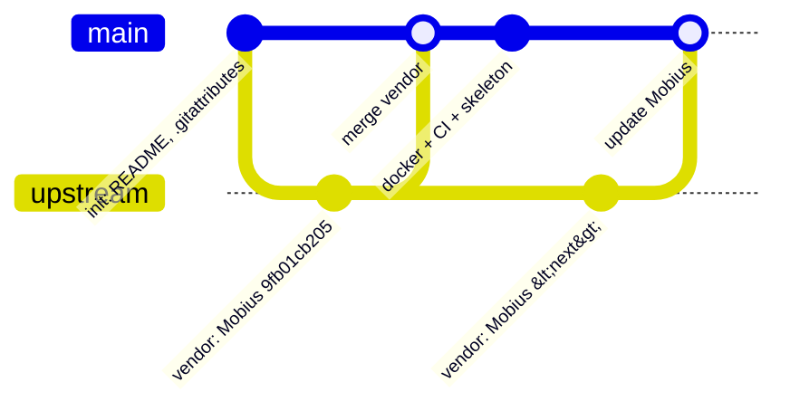

# Фаза 0: репозиторий, Docker, CI. Подробный план

*10 октября 2026 (MSK). Статус: **✅ выполнено и принято 10.10.2026** (Глеб зашёл клиентом и создал персонажа; лицензия GPL-3.0 подтверждена).*
*✅ Факт (проверено). 💡 Предложение. 📏 Оценка.*

---

## 1. Цель

Получить **воспроизводимую основу** новой сборки:
1. git-репозиторий, в котором чистый Mobius лежит **байт в байт** как в upstream, с понятной схемой будущих обновлений;
2. сборку и запуск этого **немодифицированного** сервера в Docker одной командой, в профилях `solo` и `online`, на портах 2106/7777, без конфликтов с текущими контейнерами `l2-*` и `lw-*`;
3. CI на GitHub: сборка, проверка «ядро не тронуто», сборка Docker-образа;
4. пустой каркас папок для платформы и модулей и README.

Кода фич, хуков и модулей в фазе 0 **нет**: сервер должен вести себя ровно как сток Mobius.

---

## 2. Исходные факты (проверено 10.10.2026)

### 2.1 Исходник `F:\L2J_Mobius_Interlude_v10.10.26`

| Параметр | Значение |
|---|---|
| Upstream | ✅ `gitlab.com/MobiusDevelopment/L2J_Mobius`, папка `L2J_Mobius_CT_0_Interlude`, **коммит `9fb01cb205`** (master, 2026-10-10 07:11 MSK, «Raid boss spawn locations corrected and missing raid bosses added»). |
| Как проверено | ✅ git-blob SHA-1 **всех 19 144 файлов**, сводный SHA-256 списка `8b0a1264…b0b1` совпал с деревом `9fb01cb205`. У соседнего `fd6c44531d` сводная сумма другая, а java-часть та же. |
| git | ✅ Нет (`.git` отсутствует). Это распакованный архив. |
| Размер | ✅ 69,6 МБ: `java/` 8,7 МБ (1617 файлов), `dist/` 60,9 МБ (17 511 файлов; из них `game/data/stats` 32,8, `scripts` 9,7 (866 java), `libs` 4,6 МБ). Крупнейший файл 2,6 МБ (`EnchantSkillTreeData.xml`). |
| Геодата | ✅ **Не входит**: в `dist/game/data/geodata` только `Readme.txt`. Твой текущий сервер (`E:\L2J_Mobius_CT_0_Interlude`, `E:\L2J_Interlude_x100`) тоже работает **без геодаты**. У LW есть 168 файлов, 548 МБ. |
| Java / Ant | ✅ **Java 27** (`build.xml`: `JDK27.present`, `source/target="27"`, `.classpath` JavaSE-27), Ant ≥ 1.9.10. Библиотеки: HikariCP 7.0.2, mysql-connector-j 9.5.0, slf4j 2.0.17. |
| Раскладка | ✅ Та же, что у `55787efe66`: `gameserver.{entity, mechanics, …}`. |
| Строки | ✅ Смешанные CRLF/LF (например, `GameServer.java` CRLF, `Player.java` LF), `.gitattributes` upstream: только `*.sh text eol=lf`. |

### 2.2 Что изменилось с 15.08 (`55787efe66` → `9fb01cb205`)

✅ 58 коммитов, 99 файлов кода и данных, +637/−490, **без переименований, без новых и удалённых файлов**. Важное для нас:
- **Java 25 → 27** (коммит `fd6c44531d` от 09.10). Затронуты только `build.xml`, `.classpath` и настройки Eclipse, java-код одинаков с `aef47e5c4c`.
- События урона и атаки неизменяемые и создаются на каждый удар (`1ec1621bfa`); `HtmCache` отклоняет пути с `..` (`8931a19ca8`).
- Улучшения боя и AI: каст ждёт замах, атаки не отменяются, AutoPlay-кастеры подходят в радиус, мобы не сбрасывают агр через 2 минуты, территориальные спавны.
- `EffectList` (снятие баффов), `SignsPriest` (+87, правила вступления в 7S), `TradeList` (полный список предметов после сделки), `RequestEnchantItem`, `RecipeManager`, `GeoEngine` (диагональный LoS).
- Новые ключи: `CraftingInCombat` (Player.ini), `NpcSpeedsWithoutStatBonus` (NPC.ini).
- **Не изменились:** `EventType`, `ConfigLoader`, `Party`, `RequestJoinParty`, `Attackable`, SQL-схема (поменялись только данные `raidboss_spawnlist.sql`).
- Хук-лист архитектуры в силе, поправки в §5.2 `/workspace/l2_new_build_architecture.md` (HtmCache-корни, события урона, точки в `EffectList`, `SignsPriest`, `AttackableAI`).

### 2.3 Окружение на ПК Глеба

| Что | Состояние |
|---|---|
| git | ✅ 2.54.0.windows.1, Git LFS 3.7.1. `user.name=gleb.stasuyk`, `user.email=gleb.stasuyk@gmail.com`. ⚠️ **Системный `core.autocrlf=true`** (`C:/Program Files/Git/etc/gitconfig`): без мер он испортит «байт в байт». |
| GitHub | ✅ SSH-ключ `id_ed25519` работает: `ssh -T git@github.com` → «Hi Gleb-Stasuyk!». ❌ `gh` CLI не установлен, поэтому создать репозиторий из консоли нечем (нужен веб или установка gh). |
| JDK | ✅ Liberica JDK 25 (`JAVA_HOME`). ❌ JDK 27 нет. |
| Ant | ❌ Не установлен. |
| Docker | ✅ Docker 29.7.2, Compose v5.4.0, Docker Desktop (WSL2). Памяти у Docker **3,79 ГБ**, 12 CPU. ❌ `.wslconfig` **нет**. |
| ПК | ✅ 7,9 ГБ RAM всего, 12 логических ядер. |
| Диски | ✅ F: свободно 93 ГБ, E: 115,5 ГБ, C: 71,7 ГБ (там же образ WSL/Docker). |
| Контейнеры | ✅ Все остановлены: `l2-db/login/game`, `lw-db/login/game`, `site-*`, `domostroy-*`, `digital-web-1`. Тома `docker_l2-mysql-data`, `lw-db-data`, `l2site_*`, `site_*` и др. **Префикса `l2s` нет ни у одного.** |

---

## 3. Результаты фазы 0

1. Приватный GitHub-репозиторий 💡 **`Gleb-Stasuyk/l2start-server`** (имя — предложение).
2. Рабочая копия 💡 **`F:\l2start-server`**. `F:\L2J_Mobius_Interlude_v10.10.26` остаётся нетронутым эталоном (только чтение).
3. Ветки `upstream/mobius` (чистый импорт) и `main`.
4. `docker/`: Dockerfile (multi-stage JDK 27 + Ant), compose (db, db-init, login, game), профили `solo`/`online`, `start.bat`/`stop.bat`.
5. `.github/workflows/ci.yml`: сборка Ant, проверка «ядро = upstream», сборка Docker-образа.
6. Скрипты `tools/import-upstream.ps1` (+ `.sh` для CI) и `tools/verify-upstream.*` (сводная blob-сумма).
7. Каркас `platform/`, `modules/`, `docs/` (README-заглушки), `docs/PLATFORM_HOOKS.md` (пустая таблица), `docs/UPSTREAM.md`, `docs/ARCHITECTURE.md` (копия архитектуры).
8. `README.md` на русском.
9. Отчёт о проверке: скриншот входа в игру, замеры памяти, CI зелёный.

---

## 4. Структура репозитория

```text
l2start-server/
├─ core/                       # = L2J_Mobius_CT_0_Interlude байт в байт (java/, dist/, build.xml, .classpath, …)
├─ platform/README.md          # фаза 1: org.l2jmobius.platform (загрузчик модулей, API)
├─ modules/README.md           # фаза 1+: modules/<id>/{module.json, src, scripts, config, data, sql, i18n}
├─ docker/
│  ├─ Dockerfile               # build: JDK 27 + Ant → jars; runtime: JRE 27 + mariadb-client
│  ├─ docker-compose.yml       # name: l2s
│  ├─ entrypoint.sh            # роли db-init | login | game, патч ini из env
│  ├─ profiles/solo.env        # 127.0.0.1, AutoCreateAccounts=True, -Xmx поменьше
│  ├─ profiles/online.env      # PUBLIC_HOST=<IP VPS>, AutoCreateAccounts=False
│  ├─ .env.example             # пароли БД и т.п. (.env в .gitignore)
│  ├─ start.bat, stop.bat      # с проверкой портов 2106/7777 (l2-*, lw-*)
│  └─ README_DOCKER.md
├─ tools/import-upstream.ps1 / .sh, verify-upstream.ps1 / .sh, check-hooks.sh
├─ docs/ARCHITECTURE.md, PLATFORM_HOOKS.md, UPSTREAM.md
├─ .github/workflows/ci.yml
├─ upstream.lock               # repo=…, path=L2J_Mobius_CT_0_Interlude, commit=9fb01cb205, manifest_sha256=8b0a…
├─ .gitattributes, .gitignore, README.md, LICENSE (GPL-3.0, как у Mobius)
└─ build/                      # вывод Ant (../build относительно core/), в .gitignore
```

💡 Ядро лежит в `core/`, а не в корне. Так ветка-вендор целиком заменяет одну папку, инфраструктура не смешивается со стоком, а `build.xml` (он пишет в `${basedir}/../build`) кладёт результат в `l2start-server/build/`.

---

## 5. Ветки и обновление upstream


*(`upstream` на схеме = ветка `upstream/mobius`.)*

- **`upstream/mobius`:** коммиты содержат только `core/` + `upstream.lock`. Сообщение: `vendor: L2J Mobius CT_0 Interlude 9fb01cb205 (2026-10-10)`. На эту ветку не попадает ничего, кроме импортов.
- **`main`:** merge из `upstream/mobius` плюс инфраструктура. С фазы 1 изменения в `core/` допускаются только с маркером `[HOOK:id]` и записью в `PLATFORM_HOOKS.md`.
- Рабочие ветки `feature/*`, `fix/*`, в `main` через PR. Защиту `main` включим, когда CI заработает (💡).
- **Импорт** (`tools/import-upstream.ps1 -Source <папка Mobius> -Commit <hash>`):
  1. `git switch upstream/mobius`;
  2. полностью очистить `core/` и скопировать новую версию (из папки, как `F:\L2J_Mobius_Interlude_vXX`, или из sparse-клона GitLab);
  3. посчитать сводную blob-сумму, сверить с деревом upstream (если указан коммит), записать в `upstream.lock`;
  4. коммит `vendor: …`, затем `git switch main`, `git merge upstream/mobius`. Конфликты возможны только в строках `[HOOK]`.
- **Byte-exact (важно):** в репо `.gitattributes` = `* -text` (никаких преобразований EOL) + `*.sh text eol=lf` только вне `core/`, и локально `git config core.autocrlf false`. `verify-upstream` в CI сверяет сумму `core/` с `upstream.lock`, поэтому порча концов строк сразу видна.

---

## 6. `.gitignore` и геодата

```gitignore
/build/
**/bin/
*.class
/docker/.env
/docker/data/
core/dist/game/log/
core/dist/login/log/
core/dist/game/data/geodata/*.l2j
core/dist/game/data/geodata/*.dat
core/dist/game/data/crests/
*.log
.idea/
*.iml
```
(Точный список runtime-файлов уточню при первом запуске: что сервер создаёт в `dist/` и не отслеживается upstream.)

**Геодата** 💡: **вне репозитория.** 548 МБ в Git LFS упрутся в бесплатные лимиты GitHub (1 ГБ хранилища и 1 ГБ трафика в месяц, каждый checkout в CI тратит трафик). Вместо этого папка на диске, например `F:\l2start-data\geodata`, монтируется в контейнер только для чтения (`L2_GEODATA_DIR` в `.env`). Если переменная пуста, сервер работает без геодаты, как сейчас. В фазе 0 только поддержка монтирования; откуда брать геодату (набор LW, проверить формат под `GeoEngine` CT_0) решим к фазе 3, потому что ботам она нужна для пути.

---

## 7. Docker

### 7.1 Dockerfile (multi-stage)

- **build:** 💡 `eclipse-temurin:27-jdk-*`. ✅ Temurin 27 вышел 2026-10-01, на Docker Hub есть `27-jdk-ubi10-minimal`. Точный тег (ubuntu/ubi) закреплю по digest при выполнении. Ant 1.10.15 скачивается с archive.apache.org **с проверкой SHA-512** (паттерн из твоего docker LW). `ant -noinput -f core/build.xml jar`, кэш слоёв: сначала `build.xml` + `libs`, потом исходники.
- **runtime:** `eclipse-temurin:27-jre-*` + `mariadb-client` (для db-init) + `tini`. Внутрь: `LoginServer.jar`, `GameServer.jar`, `dist/libs`, `dist/game` (config, data, scripts), `dist/login`, `db_installer/sql`. Пользователь не root. Один образ на три роли.
- `.dockerignore`: `build/`, `.git/`, логи, `docker/.env`.

### 7.2 docker-compose.yml

| Сервис | Контейнер | Что делает | Порты |
|---|---|---|---|
| `db` | `l2s-db` | `mariadb:11.4` (как у `l2-db`), healthcheck `healthcheck.sh --connect --innodb_initialized` | наружу нет (опционально `127.0.0.1:3307` в `.env` для HeidiSQL) |
| `db-init` | `l2s-db-init` | одноразовый: если БД `l2start` **пустая**, импортирует `sql/login/*.sql` и `sql/game/*.sql` (часть файлов делает `DROP TABLE`, поэтому только в пустую БД). Завершается с кодом 0. | — |
| `login` | `l2s-login` | `depends_on: db-init (service_completed_successfully)`; патч `Database.ini`, `Server.ini` (`AutoCreateAccounts` из профиля), `EnableGUI=False` | **2106** |
| `game` | `l2s-game` | `depends_on: login`; `LoginHost=login`, `ipconfig.xml` → `PUBLIC_HOST`, heap из env, геодата из `L2_GEODATA_DIR` (ro) | **7777** |

- `name: l2s` в compose задаёт уникальные имена: контейнеры `l2s-*`, тома `l2s_db-data`, `l2s_game-logs`, `l2s_login-logs`, сеть `l2s_default`. С `l2-*`, `lw-*`, `site-*` не пересекается (✅ проверено по списку).
- Конфиги: entrypoint копирует стоковые `config/` в runtime-каталог и применяет ключи из env/профиля. Это простой прообраз системы профилей из архитектуры, исходники `core/` не трогаются.
- **Профили:** `docker compose --env-file profiles/solo.env up -d` (или `start.bat solo`).

| Ключ | solo | online |
|---|---|---|
| `PUBLIC_HOST` | `127.0.0.1` | IP VPS |
| `BIND_ADDR` портов | `127.0.0.1` | `0.0.0.0` |
| `AutoCreateAccounts` | True | **False** |
| `GAME_XMX` / `LOGIN_XMX` | 2g / 256m (под текущие 3,8 ГБ Docker) | по VPS (позже) |
| `restart` | `no` | `unless-stopped` |

- `start.bat solo|online`: проверяет, заняты ли 2106/7777 контейнерами `l2-*`/`lw-*`, и **спрашивает**, остановить ли их (так же, как `start_livingworld.bat`), затем `up -d` и ждёт строку регистрации game на login. `stop.bat`: `down` без удаления томов, предлагает вернуть прежний сервер.
- Healthcheck login: TCP 2106. game: TCP 7777 + лог «registered».

### 7.3 Память

✅ Docker сейчас 3,79 ГБ. Стоковый сервер без ботов (game 2 ГБ heap + login + MariaDB) 📏 укладывается, так как твой `l2-*` в тех же условиях работал. **Для фазы 0 менять `.wslconfig` не обязательно.** К фазе 3 (боты) понадобится больше. На ПК всего 7,9 ГБ, а рядом работает клиент L2, поэтому реалистично `memory=5GB`. Это решение Глеба (вопрос 5): `wsl --shutdown` остановит все контейнеры.

---

## 8. CI (GitHub Actions, `.github/workflows/ci.yml`)

| Job | Шаги | Когда |
|---|---|---|
| `build` | checkout → `actions/setup-java` (temurin, 27) → Ant 1.10.15 (кэш) → `ant -f core/build.xml jar` → артефакт с jar (7 дней) | push, PR |
| `verify-core` | `fetch-depth: 0`; `tools/verify-upstream.sh` (сумма `core/` на `upstream/mobius` = `upstream.lock`); `tools/check-hooks.sh`: diff `core/` между `upstream/mobius` и HEAD. **Фаза 0: diff должен быть пустым.** С фазы 1 каждый изменённый hunk обязан содержать `[HOOK:` и иметь строку в `PLATFORM_HOOKS.md` (пока заглушка, которая печатает список) | push, PR |
| `docker` | `docker build` без push (проверка Dockerfile) | push в main, PR |
| `smoke` (💡 опционально) | compose up db+db-init+login+game → дождаться регистрации game (таймаут 10 мин) → down | вручную (`workflow_dispatch`) или nightly |

📏 Приватный репо на GitHub Free: 2000 минут Actions в месяц; build+verify+docker ≈ 4–6 мин на push.

---

## 9. Порядок выполнения (после одобрения)

| # | Шаг | Где | Кто |
|---|---|---|---|
| 1 | Создать пустой приватный репо (без README/лицензии) | github.com/new | **Глеб** (или gh CLI, см. вопрос 2) |
| 2 | `git init F:\l2start-server`, `core.autocrlf=false` (локально), `.gitattributes`, первый коммит | ПК | я |
| 3 | Ветка `upstream/mobius`: копия `F:\L2J_Mobius_Interlude_v10.10.26` → `core/` (robocopy, только чтение источника), `upstream.lock`, проверка суммы `8b0a1264…`, коммит | ПК | я |
| 4 | `main`: merge, каркас, docker, tools, CI, README | ПК | я |
| 5 | `docker compose build`, `start.bat solo`, проверка логов, замер памяти (`docker stats`) | ПК (Docker) | я |
| 6 | Вход клиентом через лаунчер («Локальный сервер»), создание персонажа, вход в мир | ПК | **Глеб** (5 минут) |
| 7 | Рестарт: данные сохранились; `stop.bat`: порты освобождены, `l2-*`/`lw-*` и их тома не тронуты (сравнение `docker ps -a` / `docker volume ls` до и после) | ПК | я |
| 8 | `git push -u origin main upstream/mobius` по SSH, CI зелёный | GitHub | я |
| 9 | Отчёт | чат | я |

---

## 10. Что НЕ входит в фазу 0

- Любые правки `core/` (хуки, багфиксы, конфиги внутри `core/`); платформа и загрузчик модулей (фаза 1).
- Кастомы (баффер, GM shop, профы и т.д., фаза 2), боты (фаза 3+), LLM.
- Перенос персонажей и БД с текущих серверов; изменения в `E:\L2J_Mobius_CT_0_Interlude`, `E:\L2-Living-Worlds`, контейнерах `l2-*`/`lw-*`/`site-*`.
- Деплой на VPS (профиль `online` только описывается и собирается, но не выкатывается).
- Скачивание и подбор геодаты (только поддержка монтирования).
- Установка JDK 27 и Ant на Windows (сборка в Docker), изменение `.wslconfig` (только по решению Глеба).
- Публикация solo-комплекта на сайте.

---

## 11. Критерии приёмки

1. ✅-проверка: `tools/verify-upstream` даёт для `core/` на `upstream/mobius` сумму **`8b0a1264c489787bf03607ed814770ff26dfbc73449aa8947eab565b2726b0b1`** (19 144 файла), что равно `9fb01cb205`.
2. `git diff upstream/mobius main -- core/` пустой.
3. `docker compose build` проходит локально, размер образа зафиксирован.
4. `start.bat solo` на пустом томе: db-init импортирует SQL, login слушает 2106, game регистрируется на login и слушает 7777. Время старта и память контейнеров записаны.
5. Клиент через лаунчер «Локальный сервер» логинится, создаёт персонажа, входит в мир. Автосоздание аккаунта работает в `solo` и выключено в `online` (проверка ini в контейнере).
6. Повторный старт: аккаунт и персонаж на месте (данные в томе `l2s_db-data`).
7. `stop.bat` освобождает порты; `docker ps -a` и `docker volume ls` для `l2-*`, `lw-*`, `site-*` не изменились.
8. На GitHub CI зелёный (`build`, `verify-core`, `docker`), README воспроизводим по шагам.

---

## 12. Риски

| Риск | Вероятность | Что делаем |
|---|---|---|
| **Java 27 вышла 1 октября**, Mobius перешёл на неё 9 октября: теги образов, `setup-java`, Ant могут вести себя непредсказуемо | средняя | Закрепить образы по digest; Ant 1.10.15 поддерживает новые JDK. Если сборка упадёт, сообщу и предложу вариант (без правок `core/`). |
| Системный `autocrlf=true` испортит байт-точность | высокая без мер | `.gitattributes * -text` + локальный `autocrlf=false` + `verify-upstream` в CI. |
| Мало памяти (Docker 3,8 ГБ, ПК 7,9 ГБ вместе с клиентом) | средняя | `GAME_XMX=2g` в `solo`, замер `docker stats`. Решение по `.wslconfig` за Глебом. |
| Порты 2106/7777 заняты `l2-*`/`lw-*` | высокая при запуске | `start.bat` спрашивает и останавливает только по согласию. |
| Регистрация game на login (hexid, `AcceptNewGameServer`, `ipconfig`) в Docker | низкая | Решение уже работало в docker LW, переносим. |
| Нет `gh`, репозиторий создаётся вручную | — | Глеб создаёт пустой репо в вебе (1 минута) или ставим gh (вопрос 2). |
| Скорость сборки из `F:` в WSL (контекст ~70 МБ, 19 тыс. файлов) | низкая | `.dockerignore`, кэш слоёв. |
| GPL-3.0: если solo-комплект раздаётся с сайта, получатели вправе получить исходники | — | Приватный репо для разработки допустим. При публичной раздаче бинарников нужно давать исходники (решим позже, к публикации). |

---

## 13. Оценка времени

📏 **S, около одного рабочего дня агента**: репо и импорт 1–2 ч, Docker 3–4 ч, CI 1–2 ч, проверка и отчёт 1–2 ч. Плюс ~5 минут Глеба на создание репо и ~5–10 минут на вход клиентом. Без учёта ожидания CI и возможных проблем с Java 27.

---

## 14. Вопросы к Глебу (нужны до старта)

1. **Имя и видимость репо:** `Gleb-Stasuyk/l2start-server`, приватный, подходит?
2. **Создание репо:** создашь пустой репо на github.com/new сам (без README и лицензии) или поставить `gh` CLI (`winget install GitHub.cli`, затем ты один раз делаешь `gh auth login`)?
3. **Рабочая папка:** `F:\l2start-server` подходит?
4. **Геодата:** держим вне git и монтируем из папки на диске (`F:\l2start-data\geodata`), а саму геодату подберём к фазе 3. Согласен?
5. **Память Docker:** для фазы 0 хватает текущих 3,8 ГБ. Поднять ли сейчас до 5 ГБ через `.wslconfig` (нужен `wsl --shutdown`, он остановит все контейнеры) или отложить до фазы 3?
6. **JDK 27 + Ant на Windows** (чтобы собирать в Eclipse без Docker): ставить сейчас или пока хватит сборки в Docker?
