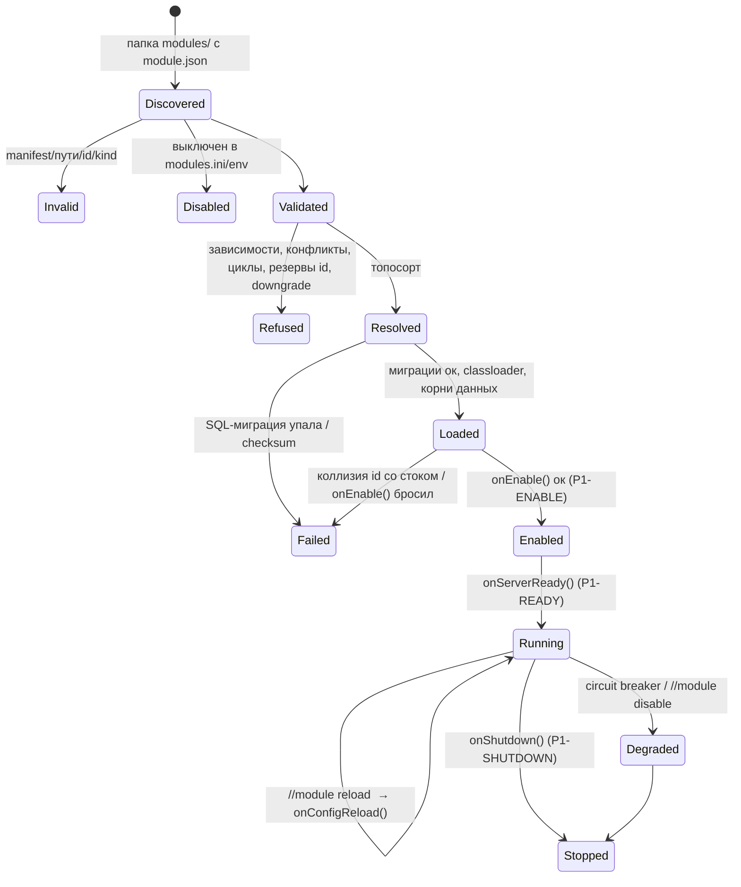

# Фаза 1: platform hooks + загрузчик модулей. Подробный план

*10 октября 2026 (MSK). Статус: **на согласовании**. Код не пишется, пока Глеб не одобрит план.*
*База: `F:\l2start-server`, ветка `main` (`core/` = L2J Mobius CT_0 Interlude `9fb01cb205`, Java 27). Фаза 0 принята 10.10.2026.*
*✅ Факт (проверено по коду `9fb01cb205`). 💡 Предложение. 📏 Оценка.*

---

## 0. Коротко

Фаза 1 строит **фундамент для всех модулей**: платформу (`platform/`), которая находит модули, проверяет
их, решает зависимости, применяет SQL-миграции, подключает данные (NPC, спавны, мультиселлы, байлисты,
HTML) и код, а затем включает модули с изоляцией сбоев. Для этого в `core/` добавляются
**9 однострочных хуков в 7 файлах** (~12 строк). Игровых фич в фазе 1 нет, только демонстрационный
модуль `hello`, который прогоняет каждый механизм платформы.

Главное правило: **если все модули выключены, сервер ведёт себя как сток** (проверяется в CI).

---

## 1. Цель и результаты

**Цель.** Чтобы фаза 2 (кастомы как модули) и фаза 3 (ядро ботов) писались **только в `modules/`**, без
правок `core/`, кроме точечных policy-хуков, которые придут вместе со своим первым потребителем.

**Результаты (deliverables):**

| # | Что | Где |
|---|---|---|
| D1 | 9 хуков в `core/` с маркерами `[HOOK:P1-..]`, таблица в `docs/PLATFORM_HOOKS.md` | `core/java/...` |
| D2 | Платформа: загрузчик, резолвер, миграции, конфиг, рантайм, админ-команды, Platform API v1 | `platform/src/main/java/org/l2start/platform/` |
| D3 | Корневой `build.xml` (сборка ядра + платформы + модулей + тесты), `core/build.xml` не трогаем | корень репо |
| D4 | Модуль `hello` (код + данные + SQL + i18n + тесты) | `modules/hello/` |
| D5 | Тестовые модули-«поломки» для smoke-теста (в образ не попадают) | `platform/test/fixtures/modules/` |
| D6 | Unit-тесты (JUnit 5), smoke-тест в Docker, `check-hooks.sh` v2 и тест на него | `platform/src/test`, `tools/` |
| D7 | Docker: модули в образе, `L2_PROFILE`, `modules.local.ini`, `docker/modules.env` | `docker/` |
| D8 | CI: build → test → verify-core → docker + smoke | `.github/workflows/ci.yml` |
| D9 | Документация: `docs/MODULES.md` (как писать модуль), `docs/PLATFORM_API.md`, `docs/ID_RANGES.md`, обновлённые `PLATFORM_HOOKS.md`, `UPSTREAM.md`, `README.md` | `docs/` |

---

## 2. Хуки фазы 1

### 2.1 Принцип отбора

💡 Хук попадает в `core/` **в той фазе, где у него появляется первый потребитель и тест**. Хук «на
будущее» без потребителя никто не проверяет, и при обновлении Mobius он тихо ломается. Поэтому:

- **Фаза 1** — хуки, без которых не работает сам загрузчик и данные модулей (нужны и фазе 2, и фазе 3).
- **Фаза 2** — policy-хуки её модулей (H18–H20). **Фаза 3** — хуки ботов (H6, H10–H17, H21–H23).
  Их точные места уже известны (см. §2.5), они ставятся по той же конвенции и той же CI-проверке.

Отличия от черновика дорожной карты (там было «H1–H5, H22, H23»):

| Было | Стало | Почему |
|---|---|---|
| H3 `ScriptEngine` (script-модули) | **не нужен вообще** | ✅ `javax.tools.JavaCompiler` доступен в рантайме (образ на полном JDK), платформа может компилировать скрипты модулей сама, без правки `ScriptEngine`. А сами script-модули откладываем (§4.2). |
| H4 `ItemData`, `SkillData` | перенос в фазу, где понадобятся свои предметы/скиллы | фазе 2 хватает стоковых предметов и скиллов (баффер, GM-шоп, стартовая экипировка). |
| H5 `CommunityBoardHandler` | перенос | в фазе 2 нет модулей с вкладками борда. |
| H22 `Player.isBot`, H23 `LoginController` | перенос в фазу 3 | потребитель — `bots-core`. |

### 2.2 Список хуков фазы 1

Все хуки — **одна добавленная строка**, вызов статического метода `org.l2start.platform.hooks.CoreHooks`
по **полному имени класса** (без `import`, чтобы не трогать блок импортов, который чаще всего
конфликтует при мерже). Когда модулей нет, каждый вызов — это проверка пустого списка или `null`.

Номера строк ✅ по `9fb01cb205`.

| Id | Файл (`core/java/org/l2jmobius/gameserver/…`) | Метод | Точка вставки | Что вызывает | Зачем | Строк |
|---|---|---|---|---|---|---|
| **P1-BOOT** | `GameServer.java` | конструктор `GameServer()` | после `ScriptEngine.getInstance();` (стр. 209): БД и `ThreadPool` уже есть, ни один лоадер данных ещё не запущен | `CoreHooks.bootstrap()` | discover → validate → resolve → **SQL-миграции** → classloader’ы → регистрация корней данных. Должно быть **до** `BuyListData` (237), `MultisellData` (238), `NpcData` (283) | 1 |
| **P1-ENABLE** | `GameServer.java` | `GameServer()` | после блока `try { … executeScriptList(); } catch …` (стр. 337), **до** `SpawnData.getInstance();` (339) | `CoreHooks.enableModules()` | `onEnable()` модулей: регистрация событий, admin/voiced/bypass-обработчиков. После `MasterHandler` (стоковые обработчики уже есть), до спавнов (слушатели `ON_NPC_SPAWN` модулей видят и стоковые, и свои спавны) | 1 |
| **P1-READY** | `GameServer.java` | `GameServer()` | перед `new ConnectionManager<>(…)` (стр. 443) | `CoreHooks.serverReady()` | `onServerReady()`: мир загружен, сеть ещё закрыта. Здесь фаза 3 будет поднимать ботов | 1 |
| **P1-SHUTDOWN** | `Shutdown.java` | `startShutdownActions()` | сразу после `_countdownFinished = true;` (стр. 345), до сохранения офлайн-торговцев и `disconnectAllCharacters()` | `CoreHooks.shutdown()` | `onShutdown()` модулей: сохранить состояние, пока игроки онлайн и БД жива; отмена задач модулей. ✅ Это единственный путь выключения (и `//shutdown`, и SIGTERM от `docker stop` через `Runtime.addShutdownHook`) | 1 |
| **P1-DATA-NPC** | `data/xml/NpcData.java` | `load()` | после блока `CustomNpcData`, перед `loadNpcsSkillLearn();` (стр. 87) | `for (File d : CoreHooks.dataDirs("npcs", id -> _npcs.containsKey(id))) parseDirectory(d, true);` | NPC модулей. Предикат даёт платформе проверить **коллизию id со стоком** до парсинга (модуль с конфликтом не грузит свои NPC и уходит в `FAILED`). Работает и при `//reload npc` | 1 |
| **P1-DATA-MSELL** | `data/xml/MultisellData.java` | `load()` | после блока `CustomMultisellLoad`, перед `verify();` (стр. 80) | то же, `"multisell"`, предикат по `_entries` | мультиселлы модулей (GM-шоп фазы 2); `verify()` проверит и их | 1 |
| **P1-DATA-BUY** | `data/xml/BuyListData.java` | `load()` | после блока `CustomBuyListLoad`, перед логом `Loaded … buyLists` (стр. 67) | то же, `"buylists"`, предикат по `_buyLists` | байлисты модулей (магазины фазы 2) | 1 |
| **P1-DATA-SPAWN** | `data/xml/SpawnData.java` | `load()` | после `checkMissingFiles(new File(".", "data/spawns"));` (стр. 111), внутри `if (!NO_SPAWNS)`, **до** цикла `initialSpawn()` | `for (File d : CoreHooks.dataDirs("spawns", null)) parseDirectory(d, true);` | спавны модулей. Стоят до `initialSpawn()`, поэтому спавнятся вместе со стоком и корректно переживают `//reload spawn` | 1 |
| **P1-HTML** | `cache/HtmCache.java` | `getHtm(Player, String)` | перед комментарием `// In case localisation does not exist…` (стр. 185) | `if ((content == null) && path.startsWith("data/html/modules/")) content = CoreHooks.moduleHtml(prefix, path);` | HTML модулей по адресу `data/html/modules/<id>/…` из **отдельного разрешённого корня** `modules/<id>/data/html/` (✅ `getHtm` с `9fb01cb205` отклоняет пути с `..`, поэтому путь «наружу» не годится; проверка `..` стоит выше хука и продолжает работать). Работает при `HtmCache = True` и `False`, учитывает языковой префикс | 1–2 |

**Итого:** 9 хуков, 7 файлов, ~10–12 добавленных строк, **0 удалённых**.

Что **не** требует хука (✅ проверено):

- **Admin-команды модулей:** `AdminCommandHandler.registerHandler/removeHandler` публичные; права
  ✅ `AdminData.hasAccess` автоматически выдаёт команду без записи в `AdminCommands.xml` **высшему**
  уровню доступа. Стоковый `AdminCommands.xml` не меняем.
- **Voiced-команды (`.hello`):** ✅ `ChatGeneral` вызывает `VoicedCommandHandler` без конфиг-флага.
- **События:** ✅ `ListenersContainer.addListener/removeListenerIf`, `ConsumerEventListener(container, type, callback, owner)`,
  `Containers.Global/Players/Npcs/Monsters()`, шаблоны NPC — всё публичное. Нужные в фазах 1–2
  события (`ON_PLAYER_LOGIN/LOGOUT`, `ON_NPC_FIRST_TALK`, `ON_PLAYER_BYPASS`, `ON_SERVER_START`…) уже есть.
- **Задачи:** `ThreadPool.schedule/scheduleAtFixedRate` публичные.
- **Отвергнутая альтернатива для данных:** копировать данные модулей в стоковые `custom/`-папки при
  старте (ноль хуков). Минусы: запись в датапак во время работы, плоский `multisell/custom` (коллизии
  имён), «мусор» после удаления модуля, нельзя проверить коллизии id. Хуки дешевле и честнее.

### 2.3 Конвенция маркеров `[HOOK]`

```java
// Однострочный хук (основной вариант, все хуки фазы 1 такие):
		org.l2start.platform.hooks.CoreHooks.enableModules(); // [HOOK:P1-ENABLE]

// Блок (только если хук не помещается в строку; в фазе 1 не используется):
		// [HOOK:P3-CLIENTLESS] >>>
		if (org.l2start.platform.hooks.CoreHooks.clientlessRequest(target, requester, RequestType.PARTY)) { return; }
		// [HOOK:P3-CLIENTLESS] <<<
```

Правила:

1. Изменение в `core/` = **только добавление строк**. Удалять или менять стоковые строки нельзя: нужно
   изменить поведение — оборачиваем вызовом хука, который возвращает «обработано/нет».
2. Каждая добавленная строка содержит `[HOOK:<id>]` **или** стоит между `[HOOK:<id>] >>>` и `[HOOK:<id>] <<<`.
3. Ни одного `import` в `core/`: только полные имена классов `org.l2start.platform...`.
4. Новых файлов в `core/` нет; весь код платформы в `platform/`.
5. `<id>` = `P<фаза>-<ИМЯ>`; каждый id есть в таблице `docs/PLATFORM_HOOKS.md`, и каждый id из таблицы
   реально встречается в `core/` (нет «мёртвых» записей).

### 2.4 CI-проверка `tools/check-hooks.sh` v2

```text
base = последний коммит "vendor:" (ветка upstream/mobius), который влит в HEAD
git diff -U0 base HEAD -- core/   → разбор по hunk'ам:
  - новые/удалённые/переименованные файлы в core/          → FAIL
  - строка "-" (удаление/изменение стока)                    → FAIL
  - строка "+" без [HOOK:id] и вне блока >>> … <<<           → FAIL
  - незакрытый блок, id в <<< не совпадает с >>>             → FAIL
  - id нет в docs/PLATFORM_HOOKS.md                         → FAIL
  - id из таблицы не найден в core/                         → FAIL
вывод: список хуков (файл:строка:id) + итог; exit 1 при любой ошибке
```

- `tools/test-check-hooks.sh` собирает во временном git-репо 8 сценариев (норма-строка, норма-блок,
  без маркера, удаление, новый файл, неизвестный id, мёртвый id, незакрытый блок) и сверяет exit-код.
  Запускается в CI, чтобы сама проверка не «сломалась молча».
- **Обновление Mobius остаётся простым.** Процесс из фазы 0 не меняется: новый апстрим кладётся в ветку
  `upstream/mobius` коммитом `vendor:`, затем `git merge` в `main`. Хуки — отдельные добавленные строки
  без импортов, поэтому конфликт возможен только если Mobius правит **соседнюю** строку. После мержа:
  `verify-upstream.sh` (вендор = `upstream.lock`), `check-hooks.sh` (diff = только хуки),
  `tools/hook-report.sh` (печатает каждый хук с 3 строками контекста: глазами проверить, что точка
  вставки не «уехала» по смыслу), сборка и smoke. Это дописывается в `docs/UPSTREAM.md`.

### 2.5 Хуки следующих фаз (для понимания объёма; в фазе 1 **не** ставятся)

| Id (черновик) | Фаза | Где (✅ класс есть в `9fb01cb205`) | Зачем |
|---|---|---|---|
| P2-BUFFLIMIT (H18) | 2 | `EffectList` (против нового кода снятия баффов) | раздельные лимиты баффов |
| P2-AUTOLEARN (H19) | 2 | `SkillTreeData` | `qol-autolearn` |
| P2-SEVENSIGNS (H20) | 2 | `SevenSigns`, `SignsPriest` (+87 строк в апстриме) | соло-режим Семи Печатей |
| P2-DATA-ITEM/SKILL (H4) | 2, если модулю нужны свои предметы | `ItemData`, `SkillData` | только при реальной потребности |
| P3-BOT (H22) | 3 | `Player`: поле `BotHandle` + `isBot()` | маркер бота |
| P3-LOGIN (H23) | 3 | `LoginController` | запрет входа на бот-аккаунты |
| P3-PARTY (H6), P3-CLIENTLESS (H10), P3-SINK (H11) | 3 | `Party`, `RequestJoinParty` и др., `Player.sendPacket` | бот без клиента |
| P3-POLICY-* (H12–H17, H21) | 3 | `Player.isAutoAttackable`, `Party`, `PlayerInventory`, `CaptchaManager`, `AttackableAI`… | боевые и экономические политики |

Policy-реестр (`ctx.policies()`) появится в API в фазе 2 вместе с первым policy-хуком (это минорное
расширение API v1 → v1.1, совместимое).

---

## 3. Где живёт код и как собирается

### 3.1 Раскладка репозитория (новое выделено)

```text
l2start-server/
  core/                        # Mobius байт в байт + 9 строк хуков
  build.xml                    # ★ корневая сборка (core + platform + modules + tests)
  platform/
    src/main/java/org/l2start/platform/   # ★ платформа
    src/main/resources/sql/               # ★ миграции самой платформы
    src/test/java/...                     # ★ unit-тесты
    test/fixtures/modules/...             # ★ модули-поломки для smoke
    dist/game/config/modules.ini          # ★ дефолты (попадает в образ)
    dist/game/config/platform.ini         # ★
  modules/
    module-build.xml           # ★ общий Ant-скрипт сборки одного модуля
    hello/                     # ★ демонстрационный модуль
  docker/ tools/ docs/ .github/
```

Пакеты: платформа `org.l2start.platform.*`, модули `org.l2start.modules.<id>.*`. Отдельный неймспейс
гарантирует, что апстрим никогда не столкнётся с нашими классами.

### 3.2 Решение: платформа компилируется **вместе с ядром** в `GameServer.jar`, но исходники лежат в `platform/`

| Вариант | Плюсы | Минусы |
|---|---|---|
| A. Исходники платформы внутри `core/java` | стоковый `core/build.xml` собирает всё сам | новые файлы в `core/` ломают правило «core = апстрим + хуки», мешают мержам |
| B. Отдельный `platform.jar`, ядро не знает о платформе | чистое разделение | невозможно: хуки в ядре ссылаются на `CoreHooks`, а платформа на классы ядра (`Player`, события) — **циклическая** зависимость двух jar |
| **C. 💡 Общая компиляция `core/java` + `platform/src` корневым `build.xml`** | `core/` содержит только хуки, `core/build.xml` не трогаем (мержится как есть), один `GameServer.jar`, никаких проблем с classpath | стоковый `core/build.xml` сам по себе больше не собирает ядро (хуки ссылаются на платформу) — это нормально, CI и Docker используют корневой |

### 3.3 Корневой `build.xml` (Ant, без ant-contrib)

| Цель | Что делает |
|---|---|
| `compile` | `javac release=27` по `core/java` + `platform/src/main/java`, classpath = `core/dist/libs/*.jar` → `build/classes` |
| `jar` | `LoginServer.jar` (те же include/exclude, что в стоковом `core/build.xml`, **без** платформы) и `GameServer.jar` (ядро + платформа), тот же `Main-Class`/`Class-Path` манифест → `build/dist/libs/` |
| `modules` | `<subant genericantfile="modules/module-build.xml">` по каждой папке `modules/*` (кроме `_*`): компиляция `src/` против `build/classes` → `build/dist/game/modules/<id>/<id>.jar` + копия `module.json`, `config/`, `data/`, `sql/`, `i18n/` |
| `dist` | `jar` + `modules` + `platform/dist/game/config/*` → `build/dist/` |
| `test` | компилирует `platform/src/test` и `modules/*/test`, запускает JUnit 5 через `junit-platform-console-standalone` (скачивается `<get>` в `build/tools/` с проверкой SHA-512, в репо не коммитится), отчёт в `build/test-reports/` |
| `clean` | удаляет `build/` |

**Синхронизация со стоковой сборкой.** Единственное, что надо повторять за апстримом, — версия Java и
include/exclude jar'ов. CI-шаг `build-sync` сравнивает `release`/`source` из `core/build.xml` с корневым
и падает при расхождении (так мы заметили бы переход Java 25 → 27 автоматически).

### 3.4 Docker

- **Build stage:** `COPY build.xml platform/ modules/ core/java core/dist/libs` → `ant -noinput dist`
  (тесты в образе не гоняем, они в CI).
- **Runtime stage:** + `build/dist/game/modules` → `/opt/l2/game/modules`, + `modules.ini`, `platform.ini` → `/opt/l2/game/config/`.
- **Compose (`game`):** `L2_PROFILE: "${L2S_PROFILE:-solo}"`; `env_file: [{path: ./modules.env, required: false}]`
  (локальный gitignored-файл для `L2_MODULE_*`/`L2_MOD_*`).
- **Entrypoint:** копирует `overrides/<profile>/game/config/modules.local.ini`, `platform.local.ini` и
  `overrides/<profile>/game/config/modules/*.ini` в `/opt/l2/game/config/` (целиком; key-патч для них не
  нужен, потому что это наши файлы, а не стоковые).
- `docker/compose.smoke.yml`: монтирует `platform/test/fixtures/modules` в `/opt/l2/game/modules-fixtures`
  и задаёт `L2_PLATFORM__MODULEROOTS=modules,modules-fixtures`. Только для smoke-теста.

### 3.5 CI (`.github/workflows/ci.yml`)

| Job | Шаги | Когда |
|---|---|---|
| `build` | `ant dist`, артефакты: jar'ы + `build/dist/game/modules` | push, PR |
| `test` | `ant test`, артефакт с отчётом | push, PR |
| `verify-core` | `verify-upstream.sh`, `check-hooks.sh` v2, `test-check-hooks.sh`, `build-sync`, валидация всех `modules/*/module.json` (тот же `ManifestReader`, CLI-режим) | push, PR |
| `docker` | сборка образа | push, PR |
| `smoke` | §6.2 | 💡 push в `main`, PR, ручной запуск (~10–15 мин) |

---

## 4. Platform API v1

### 4.1 Интерфейсы модуля

```java
package org.l2start.platform.api;

public interface GameModule {
  void onEnable(ModuleContext ctx) throws Exception;         // регистрации; исключение → FAILED + откат регистраций
  default void onServerReady(ModuleContext ctx) throws Exception {}  // мир загружен, сеть ещё закрыта
  default void onConfigReload(ModuleContext ctx) throws Exception {} // //module reload <id>
  default void onShutdown(ModuleContext ctx) throws Exception {}     // сохранение; есть таймаут
}

public interface ModuleContext {
  ModuleInfo       self();       // id, версия, профиль, пути (root, data, html, config)
  ModuleLog        log();        // java.util.logging с префиксом [id], уровень из конфига
  ModuleConfig     config();     // типизированный конфиг (§4.6), reloadable
  ModuleEvents     events();     // стоковые события Mobius с владельцем
  ModuleHandlers   handlers();   // admin / voiced / bypass с владельцем
  ModuleScheduler  scheduler();  // задачи с владельцем, метриками и защитой
  ModuleDatabase   db();         // соединения из стокового пула + хелперы
  ModuleResources  resources();  // файлы модуля (data/xml, произвольные), html-пути
  ModuleI18n       i18n();       // messages_{ru,en}.properties, язык игрока
  ServiceRegistry  services();   // provide/require между модулями (интерфейсы)
  ModuleMetrics    metrics();    // счётчики и таймеры (видны в //module info)
}
```

| Подсистема | Содержимое v1 | Как устроено |
|---|---|---|
| `events()` | `onPlayer(EventType, Consumer)`, `onNpc(npcId, EventType, Consumer)`, `onGlobal(...)`, `onMonsters(...)`, `notifyAsync(...)` | обёртка над `ConsumerEventListener` c `owner = модуль`; каждый вызов в try/catch + счётчик ошибок + время; при выключении `removeListenerIf(owner == модуль)` |
| `handlers()` | `admin(IAdminCommandHandler)`, `voiced(IVoicedCommandHandler)`, `bypass(IBypassHandler)` | регистрация в стоковых `*Handler` через обёртку-делегат с try/catch; конфликт имени команды со стоком или другим модулем → ошибка регистрации (модуль `FAILED`), сток **не** перетирается |
| `scheduler()` | `schedule(name, delay, Runnable)`, `fixedRate(name, initial, period, Runnable)`, `cancelAll()` | поверх `ThreadPool`; имя обязательно; обёртка считает ошибки и время, отменяется при выключении модуля |
| `db()` | `connection()`, `query/update` хелперы, `table("counter")` → `mod_hello_counter` | ✅ `DatabaseFactory.getConnection()` (стоковый пул), отдельного пула нет |
| миграции | только декларативно: `sql/V###__описание.sql` | применяет платформа до `onEnable` (§4.8) |
| `resources()` | `path("data/xml/foo.xml")`, `html("npc.htm")` → `"data/html/modules/hello/npc.htm"` | только внутри корня модуля; `..` и абсолютные пути запрещены |
| `i18n()` | `get(player, key, args...)`, `get(lang, key, args...)` | `i18n/messages_<lang>.properties` (UTF-8), язык = ✅ `Player.getLang()`, fallback `en` → ключ; HTML по-прежнему через стоковый мультиязычный префикс |
| `services()` | `provide(Class<T>, T)`, `require(Class<T>)`, `optional(Class<T>)` | сервис доступен только модулям, объявившим зависимость от поставщика |
| `log()` | `info/warn/error/debug` | логгер `module.<id>`, в общий лог сервера |
| `metrics()` | `counter(name)`, `timer(name)` | в памяти; вывод в `//module info` (Prometheus — позже, фаза 8) |

**Нет в v1 (придёт позже, совместимо):** `policies()` (фаза 2), `bus()` межмодульная шина (фаза 3),
`board()` вкладки Community Board, горячая выгрузка кода.

**Совместимость API.** Платформа объявляет `apiVersion = 1.0.0`. Добавление методов → `1.x`,
удаление/смена сигнатур → `2.0`. Модуль пишет `"platform": "^1.0"`.

### 4.2 Упаковка: jar-модули и script-модули

| Вид (`kind`) | Что | В фазе 1 |
|---|---|---|
| `jar` | Java из `src/`, собирается корневым `build.xml` в `<id>.jar`, тесты в `test/` | ✅ **да** |
| `data` | без кода: только `data/`, `config/`, `i18n/`, `sql/` (например, набор NPC + мультиселл) | ✅ **да** |
| `script` | `.java` в `scripts/`, компилируются при старте (как в Living Worlds) | ❌ **отложено** |

Почему `script` откладываем: ✅ стоковый `ScriptExecutor` держит **один общий** `ScriptClassLoader` и
`-sourcepath data/scripts`; модуль, компилируемый отдельно, получил бы свои копии классов из
`data/scripts` (двойные синглтоны), ошибки компиляции видны только на старте, и юнит-тестов нет. Для
монорепо, где всё собирается CI, `jar` проще и надёжнее. Если понадобится правка «без пересборки»
(например, для онлайн-сервера), добавим `script` отдельной задачей **без хука в `ScriptEngine`**
(платформа сама вызывает `javax.tools`).

**Изоляция классов.** Каждому `jar`-модулю свой `ModuleClassLoader` (URLClassLoader): родитель =
ядро + платформа; дальше поиск по classloader'ам **объявленных зависимостей**. Модули видят друг друга
только через объявленные зависимости. Песочницы нет (модуль — доверенный код из нашего репо).
Классы из `data/scripts` модулям **не видны** (только `core` + `platform`), это правило фиксируется в `docs/MODULES.md`.

### 4.3 `module.json`: схема

| Поле | Тип | Обяз. | Правило |
|---|---|---|---|
| `id` | string | да | `^[a-z][a-z0-9-]{1,31}$`, совпадает с именем папки |
| `name`, `description` | string | `name` да | для `//modules` |
| `version` | semver | да | `MAJOR.MINOR.PATCH[-pre]` |
| `kind` | `jar` \| `data` | да | |
| `platform` | диапазон | да | совместимость с API платформы |
| `entrypoint` | FQCN | для `jar` | класс `implements GameModule` с публичным конструктором без аргументов |
| `authors` | string[] | нет | |
| `dependencies` | `[{id, version, optional}]` | нет | §4.4 |
| `conflicts` | `[{id, version}]` | нет | |
| `defaultEnabled` | `{solo: bool, online: bool}` | нет (false) | если в `modules.ini` нет ключа |
| `data` | `{npcs, spawns, multisell, buylists, html}` → относительный путь | нет | папки внутри модуля |
| `reserves` | `{npcs: [[from,to]], multisell: [[from,to]], buylists: [[from,to]]}` | если есть соответствующие `data` | все id в XML модуля обязаны попадать в свои диапазоны |
| `migrations` | путь | нет (`sql`) | |
| `config` | `{Key: {type, default, min, max, values, description, reloadable}}` | нет | `type`: `bool`,`int`,`long`,`double`,`string`,`enum`,`list`,`duration` |

Неизвестные поля → предупреждение (не ошибка), чтобы старая платформа читала новые манифесты.
JSON парсит свой маленький парсер (~250 строк + тесты): в `core/dist/libs` нет JSON-библиотеки, а
добавлять jar в стоковый `libs/` нельзя (это правка `core/`).

**Пример (`modules/hello/module.json`):**

```json
{
  "id": "hello",
  "name": "Hello (демонстрация платформы)",
  "description": "Проверяет все механизмы платформы: события, команды, задачи, данные, HTML, SQL, i18n.",
  "version": "1.0.0",
  "kind": "jar",
  "platform": "^1.0",
  "entrypoint": "org.l2start.modules.hello.HelloModule",
  "authors": ["l2start"],
  "dependencies": [],
  "conflicts": [],
  "defaultEnabled": { "solo": true, "online": false },
  "data": {
    "npcs": "data/npcs",
    "spawns": "data/spawns",
    "multisell": "data/multisell",
    "html": "data/html"
  },
  "reserves": {
    "npcs": [[95000, 95009]],
    "multisell": [[95000, 95009]]
  },
  "migrations": "sql",
  "config": {
    "GreetOnLogin":    { "type": "bool", "default": true, "reloadable": true,
                         "description": "Приветствие при входе в игру" },
    "StatsLogPeriod":  { "type": "duration", "default": "10m", "min": "1m",
                         "description": "Как часто писать в лог число онлайн-игроков" },
    "MaxHelloPerDay":  { "type": "int", "default": 5, "min": 0, "max": 1000, "reloadable": true }
  }
}
```

Пример зависимостей (для фазы 3, просто как форма):

```json
"dependencies": [
  { "id": "bots-core",      "version": "^1.2" },
  { "id": "economy-market", "version": "^1.0", "optional": true }
],
"conflicts": [ { "id": "old-fakeplayers", "version": "*" } ]
```

### 4.4 Зависимости и semver

- **Версии:** semver 2.0 (`1.4.2`, `1.5.0-rc.1`); пре-релиз меньше релиза.
- **Диапазоны:** `1.2.3` (точно), `^1.2` (≥1.2.0 <2.0.0; для `0.x` — в пределах минорной), `~1.2.3`
  (≥1.2.3 <1.3.0), `>=1.0 <2.0` (через пробел = И), `*`.
- **Резолвер (детерминированный):**
  1. берём **включённые** модули (по `modules.ini`/профилю/env);
  2. проверяем `platform`, обязательные зависимости (есть, включена, версия в диапазоне), конфликты,
     пересечение `reserves` между модулями;
  3. топологическая сортировка (Kahn, при равенстве — по id), циклы → все модули цикла `REFUSED`;
  4. **каскад:** модуль, зависящий от `REFUSED`/`FAILED`, тоже `REFUSED` с причиной «depends on X»;
  5. опциональная зависимость: если есть и подходит — грузится раньше и видна; если нет — модуль работает без неё.
- Порядок `onEnable/onServerReady` = топологический; `onShutdown` = обратный.
- Даунгрейд: платформа помнит последнюю запущенную версию модуля (§4.8); если новая **ниже** — модуль
  `REFUSED` («downgrade»), чтобы старый код не работал с новой схемой БД.

### 4.5 Жизненный цикл



| Этап | Когда (хук) | Что происходит |
|---|---|---|
| discover | P1-BOOT | сканирует корни (`platform.ini: ModuleRoots`, по умолчанию `modules`), читает `module.json` |
| validate | P1-BOOT | схема, id = папка, пути только внутри модуля, `entrypoint` для `jar`, предварительный скан id в XML (`<npc id>`, имена файлов мультиселлов/байлистов) против `reserves` |
| resolve | P1-BOOT | §4.4 |
| migrate | P1-BOOT | §4.8 |
| load | P1-BOOT | classloader, загрузка `entrypoint` (только класс, без вызова), регистрация корней данных; NPC/мультиселлы/байлисты/спавны подхватываются хуками `P1-DATA-*` во время стоковой загрузки |
| enable | P1-ENABLE | `onEnable(ctx)`; при исключении — **откат всего**, что модуль успел зарегистрировать (события, команды, задачи, сервисы) |
| ready | P1-READY | `onServerReady(ctx)` |
| disable (runtime) | admin / circuit breaker | снять все регистрации модуля, состояние `Degraded`; классы не выгружаются, снова включить = рестарт |
| shutdown | P1-SHUTDOWN | `onShutdown(ctx)` в обратном порядке, таймаут 10 с на модуль (настраивается), затем `cancelAll()` задач |

**Включение/выключение кода — через рестарт** (как в LW, надёжно). **Горячо:** конфиг (`reloadable`
ключи), i18n, HTML модулей (кэш сбрасывается), данные — стоковыми `//reload npc|multisell|buylist|spawn`
(хуки P1-DATA-* подхватят папки модулей автоматически).

### 4.6 `modules.ini`, `platform.ini`, профили и env

**Профиль** = `L2_PROFILE` (Docker: из `L2S_PROFILE`), по умолчанию `solo`. Значения `solo`, `online`;
другое имя допускается с предупреждением.

Формат наших ini: ключи в начале файла действуют для всех профилей, секции `[solo]` / `[online]`
переопределяют. (Стоковые ini Mobius не трогаем, это только для файлов платформы и модулей.)

`config/modules.ini` (в образе) — что включено:

```ini
# Включение модулей: <id> = on | off. Нет ключа → defaultEnabled из module.json.
hello = on

[online]
hello = off
```

`config/platform.ini` — настройки платформы:

```ini
ModuleRoots = modules
FailurePolicy = continue       # continue: сервер стартует без сломанного модуля; abort: остановить старт
BreakerErrors = 20             # ошибок модуля за окно → Degraded
BreakerWindow = 60s
ShutdownTimeout = 10s
DisableAll = false             # true → ни один модуль не грузится (тест «как сток»)

[online]
FailurePolicy = continue       # см. вопрос 2
```

**Порядок приоритета (последний побеждает):**

| Что | 1 | 2 | 3 | 4 | 5 |
|---|---|---|---|---|---|
| включение модуля | `defaultEnabled[профиль]` | `modules.ini` | `modules.ini [профиль]` | `modules.local.ini` (+ `[профиль]`) | env `L2_MODULE_<ID>=on\|off` |
| конфиг модуля | `default` из `module.json` | `modules/<id>/config/defaults.ini` (+ `[профиль]`) | `config/modules/<id>.ini` (+ `[профиль]`) | — | env `L2_MOD_<ID>__<KEY>` |
| платформа | встроенные дефолты | `platform.ini` (+ `[профиль]`) | `platform.local.ini` | — | env `L2_PLATFORM__<KEY>` |

- В env `<ID>`: верхний регистр, `-` → `_` (`bots-core` → `BOTS_CORE`); `<KEY>` сравнивается без учёта
  регистра (`L2_MOD_HELLO__GREETONLOGIN=false`). Разделитель `__`, потому что в id бывает `-`.
- Значения проверяются по схеме из `module.json` (тип, min/max, enum). Ошибка в конфиге → модуль `FAILED`
  с понятной причиной; неизвестный ключ → предупреждение.
- `*.local.ini` и `config/modules/*.ini` берутся из `docker/overrides/<профиль>/game/config/` (фаза 0 уже
  монтирует эту папку). В git — пустые примеры `*.ini.example`.

### 4.7 Изоляция сбоев и авто-отключение

1. **Старт.** Любая ошибка модуля (манифест, зависимость, миграция, конфиг, `onEnable`) → модуль
   `INVALID/REFUSED/FAILED`, его зависимые → `REFUSED` (каскад), **остальные работают**, сервер
   стартует. Итоговая строка в логе:
   `Platform: profile=solo, 3 discovered, 1 enabled, 1 failed, 1 refused, 0 disabled (412 ms)` + причина по каждому.
   При `FailurePolicy = abort` — после итоговой строки старт прерывается (`System.exit(1)`).
2. **Рантайм.** Все точки входа в код модуля (слушатели, обработчики команд, задачи) идут через обёртки:
   исключение не уходит в ядро (команда отвечает игроку «ошибка модуля», слушатель не ломает цепочку
   стоковых), считается в счётчике модуля и пишется в лог с ограничением частоты.
3. **Circuit breaker.** ≥ `BreakerErrors` ошибок за `BreakerWindow` → модуль `Degraded`: снимаются
   все его регистрации, задачи отменяются, сервисы помечаются недоступными, зависимые тоже `Degraded`.
   Видно в `//modules`, вернуть — рестарт.
4. **Владение (ownership).** Платформа помнит всё, что модуль зарегистрировал, поэтому откат и
   отключение полные. Регистрация «мимо» платформы (прямой `ThreadPool`) не запрещена технически, но
   нарушает правила в `docs/MODULES.md` и ловится ревью.
5. **Медленные модули.** Таймер на каждый вызов; вызов дольше 100 мс (настраивается) → предупреждение
   с именем модуля и точки. Принудительного прерывания нет (Java этого безопасно не умеет).

### 4.8 Версионные SQL-миграции

- Файлы: `modules/<id>/sql/V001__create_counter.sql`, `V002__…`. Номер — целое, строго растёт; пропуски допустимы.
- Таблицы модуля обязаны иметь префикс `mod_<id_с_подчёркиваниями>_` (валидатор предупреждает,
  если `CREATE TABLE` без префикса).
- Применяются **до** `onEnable`, в порядке зависимостей, под `GET_LOCK('l2s_platform_migrations', 60)`.
- Скрипт режется на выражения по `;` в конце строки вне строк и комментариев. `DELIMITER`/процедуры в v1
  не поддерживаются (будут нужны — добавим).
- MariaDB делает неявный COMMIT на DDL, поэтому миграция **не атомарна**. Правило: одна миграция = одно
  логическое изменение, идемпотентный DDL (`CREATE TABLE IF NOT EXISTS`, `ADD COLUMN IF NOT EXISTS` — ✅ MariaDB 11.4 умеет).
- Уже применённый файл изменился (checksum) → модуль `FAILED` («migration V001 changed after apply»).
  Упавшая миграция записывается с `success=0`; при следующем старте модуль `FAILED`, пока админ не
  исправит (инструкция в `docs/MODULES.md`: поправить SQL, удалить строку с `success=0`).
- Отката (down) нет. Удаление данных модуля — вручную по `sql/remove.sql` (команда `//module purge` — не в фазе 1).

Таблицы платформы (создаёт её собственная миграция `platform V001`, только если включён хотя бы один модуль):

```sql
CREATE TABLE IF NOT EXISTS platform_module_migrations (
  module_id      VARCHAR(32)  NOT NULL,
  version        INT          NOT NULL,
  description    VARCHAR(200) NOT NULL,
  script         VARCHAR(255) NOT NULL,
  checksum       CHAR(64)     NOT NULL,          -- SHA-256 файла после нормализации CRLF → LF
  module_version VARCHAR(32)  NOT NULL,
  applied_at     DATETIME     NOT NULL DEFAULT CURRENT_TIMESTAMP,
  execution_ms   INT          NOT NULL,
  success        TINYINT(1)   NOT NULL,
  error          TEXT         NULL,
  PRIMARY KEY (module_id, version)
) ENGINE=InnoDB DEFAULT CHARSET=utf8mb3 COLLATE=utf8mb3_unicode_ci;

CREATE TABLE IF NOT EXISTS platform_modules (
  module_id       VARCHAR(32) NOT NULL PRIMARY KEY,
  last_version    VARCHAR(32) NOT NULL,              -- защита от даунгрейда
  first_seen_at   DATETIME    NOT NULL DEFAULT CURRENT_TIMESTAMP,
  last_enabled_at DATETIME    NULL,
  last_state      VARCHAR(16) NOT NULL,
  last_error      TEXT        NULL
) ENGINE=InnoDB DEFAULT CHARSET=utf8mb3 COLLATE=utf8mb3_unicode_ci;
```

### 4.9 Админ-команды

Регистрирует сама платформа (не модуль). Доступ: высший уровень доступа (стоковое авто-право, см. §2.2).

| Команда | Что делает |
|---|---|
| `//modules` | таблица в HTML-окне: id, версия, kind, состояние, ошибок (1 мин / всего), слушателей / команд / задач, время в коде модуля; итог профиля |
| `//module info <id>` | манифест, причина отказа/ошибки (последние 5 с временем), зависимости и зависимые, применённые миграции, текущий конфиг с источником каждого ключа (default / ini / env), метрики |
| `//module reload <id>` | перечитать конфиг, i18n и HTML модуля → `onConfigReload()`; ключи без `reloadable` → предупреждение «нужен рестарт» |
| `//module reload-all` | то же для всех `Running` модулей |
| `//module disable <id>` | перевести в `Degraded` до рестарта (аварийное выключение); постоянно — через `modules.ini` |

Каждое действие пишется в лог: кто, когда, что.

---

## 5. Модуль `hello`

Минимальный, но затрагивает **каждый** механизм платформы, чтобы его успешный старт что-то доказывал.

```text
modules/hello/
  module.json                         # §4.3
  MODULE.md
  config/defaults.ini                 # [online] GreetOnLogin = false — проверка секции профиля
  src/org/l2start/modules/hello/
    HelloModule.java                  # GameModule
    HelloVoiced.java                  # .hello
    HelloAdmin.java                   # //hello_stats
    HelloRepository.java              # mod_hello_counter
    Greeting.java                     # чистая логика (тестируется без сервера)
  test/org/l2start/modules/hello/
    GreetingTest.java
  sql/V001__create_counter.sql        # mod_hello_counter(char_id PK, count, day, updated_at)
  i18n/messages_ru.properties, messages_en.properties
  data/npcs/hello_npc.xml             # NPC 95000 «Hello Guide» (тип Folk, стоковая внешность)
  data/spawns/hello.xml               # один спавн рядом со стартом людей-новичков на Talking Island
  data/multisell/95000.xml            # 1 товар: Soulshot (No Grade) ×10 за 1 аден
  data/html/95000.htm, 95000-stats.htm
```

| Механизм | Как проверяется |
|---|---|
| миграции | при первом старте создаётся `mod_hello_counter`, строка в `platform_module_migrations` |
| события | `ON_PLAYER_LOGIN` → приветствие на языке игрока (если `GreetOnLogin`) |
| voiced | `.hello` → «Привет, Глеб! Ты сказал .hello 3 раз сегодня (лимит 5)», счётчик в БД |
| admin | `//hello_stats` → сколько игроков пользовались |
| задачи | раз в `StatsLogPeriod` пишет в лог число онлайн-игроков |
| NPC + спавн | NPC 95000 стоит на Talking Island (хуки P1-DATA-NPC, P1-DATA-SPAWN) |
| HTML | `ON_NPC_FIRST_TALK` по шаблону 95000 → окно `data/html/modules/hello/95000.htm` (хук P1-HTML) |
| мультиселл | кнопка в окне открывает мультиселл 95000 (хук P1-DATA-MSELL) |
| конфиг/профили | в `online` `defaultEnabled=false`, а `GreetOnLogin` выключен секцией `[online]` |
| reload | правка `config/modules/hello.ini` + `//module reload hello` меняет `MaxHelloPerDay` без рестарта |
| i18n | RU/EN по `Player.getLang()` |

Байлист в `hello` не кладём (хук P1-DATA-BUY проверяется фикстурой в smoke, §6.2), чтобы не усложнять NPC.

**Тесты `hello`:** `GreetingTest` (форматирование RU/EN, fallback на `en`, лимит в день, смена дня) +
общий тест CI «все `modules/*/module.json` валидны и все id в XML внутри `reserves`».

---

## 6. Тесты

### 6.1 Unit (JUnit 5, без сервера и без БД, `ant test`)

| Тест | Что покрывает |
|---|---|
| `JsonParserTest` | объекты, массивы, экранирование, юникод, ошибки с номером строки |
| `ManifestReaderTest` | все поля §4.3, обязательные/неизвестные поля, неверный id, id ≠ папка, `..`/абсолютные пути, `kind=jar` без `entrypoint` |
| `SemverTest`, `VersionRangeTest` | разбор, сравнение, пре-релизы, `^ ~ >= < *`, `^0.x` |
| `DependencyResolverTest` | порядок (детерминированный), нет зависимости, версия мимо, опциональная есть/нет, конфликт, цикл из 2 и 3, каскад отказов, зависимость выключена, несовместимая `platform`, даунгрейд |
| `ReservationTest` | пересечение диапазонов модулей, id вне своего диапазона, коллизия со «стоком» (предикат) |
| `IniProfilesTest`, `ConfigResolverTest` | секции профилей, полная цепочка приоритетов §4.6, env-маппинг (`bots-core` → `BOTS_CORE`), типы/min/max/enum/duration, неизвестные ключи |
| `MigrationPlannerTest` | порядок, пропуски номеров, дубликат номера, плохое имя файла, checksum (CRLF = LF), уже применённые, упавшая ранее |
| `SqlSplitterTest` | `;` в строках и комментариях, `--`, `#`, `/* */`, пустые выражения |
| `OwnershipTest` | регистрации учитываются и снимаются полностью; откат при исключении в `onEnable` (с фейковыми реестрами) |
| `CircuitBreakerTest` | порог, скользящее окно, каскад на зависимые |
| `ModuleClassLoaderTest` | модуль видит ядро/платформу и объявленные зависимости, но не чужие модули (собранные в тесте мини-jar'ы) |
| `GreetingTest` (hello) | §5 |

📏 ~120–150 тест-кейсов. Плюс `tools/test-check-hooks.sh` (8 сценариев, §2.4).

### 6.2 Smoke в Docker (`tools/smoke.sh`, CI-job `smoke`, можно запустить и локально)

Запуск с `compose.smoke.yml` и фикстурами:

| Фикстура | Ожидание |
|---|---|
| `hello` | `Running` |
| `fx-ok-dep` (зависит от `hello ^1.0`, кладёт 1 байлист) | `Running`; байлист загружен (хук P1-DATA-BUY) |
| `fx-missing-dep` | `REFUSED: dependency fx-nope missing` |
| `fx-broken-enable` (бросает в `onEnable`, до этого регистрирует слушатель) | `FAILED`, слушатель снят (лог ownership) |
| `fx-depends-on-broken` | `REFUSED` каскадом |
| `fx-bad-migration` (SQL с ошибкой) | `FAILED`, строка `success=0` |
| `fx-npc-collision` (NPC с id стокового NPC) | `FAILED`, стоковый NPC не перезаписан |
| `fx-flaky` (задача раз в 1 с бросает исключение) | через ~20 с `Degraded`, сервер жив |

Проверки скрипта:

1. `l2s-game` healthy ≤ 10 мин; итоговая строка `Platform: … 2 running, 3 failed, 2 refused`, `fx-flaky` → `Degraded`.
2. SQL: `mod_hello_counter` есть; `platform_module_migrations` содержит `hello V001 success=1`, `fx-bad-migration success=0`.
3. Рестарт `l2s-game` → миграции не применяются повторно (`applied_at` прежний), снова healthy.
4. `L2_PLATFORM__DISABLEALL=true` → `0 enabled`; счётчики стоковых лоадеров (NPC, мультиселлы, байлисты,
   спавны, скрипты) **равны базовым** из стокового запуска (`tools/smoke/baseline.txt`, снимаем один раз
   с образа фазы 0). Это и есть тест «всё выключено = сток».
5. `docker compose down -v`.

### 6.3 Ручная проверка Глебом (клиентом, ~10 минут)

`start.bat solo` → вход → приветствие → `.hello` ×2 → NPC «Hello Guide» на Talking Island → окно →
мультиселл → `//modules`, `//module info hello`. Для `//`-команд нужен GM-персонаж (вопрос 4).

---

## 7. Что НЕ входит в фазу 1

- Любые игровые фичи и кастомы (баффер, GM-шоп, рейты, автолут и т. д.) — фаза 2.
- Боты, `Player.isBot`, запросы к ботам без клиента, policy-хуки (H6, H10–H23) — фазы 2–3.
- `policies()`, межмодульная шина `bus()`, вкладки Community Board, свои предметы/скиллы модулей.
- `script`-модули и горячая выгрузка/перезагрузка кода модуля.
- Down-миграции, `//module purge`, веб-админка, Prometheus-метрики.
- Перенос кода из `E:\L2J_Mobius_CT_0_Interlude` и из Living Worlds.
- Изменения в login-сервере.
- Выкладка на VPS.

---

## 8. Критерии приёмки

1. В `core/` ровно 9 хуков из §2.2; `check-hooks.sh` v2 зелёный, `test-check-hooks.sh` зелёный,
   `verify-upstream.sh` зелёный (вендор не тронут).
2. CI зелёный целиком: `build`, `test` (все unit-тесты), `verify-core`, `docker`, `smoke`.
3. Smoke-тест проходит все пункты §6.2, включая «всё выключено = сток» по счётчикам.
4. Время старта сервера с `hello` выросло не более чем на 2 с относительно фазы 0.
5. Глеб на Windows: `start.bat solo` (пересборка образа) → ручная проверка §6.3 проходит; в `online`
   профиле `hello` выключен.
6. Документы: `docs/MODULES.md` (как написать модуль с нуля, на примере `hello`), `docs/PLATFORM_API.md`,
   `docs/ID_RANGES.md` (95000–95009 = hello), обновлены `PLATFORM_HOOKS.md`, `UPSTREAM.md`, `README.md`.
7. Работа идёт в ветке `phase1` → PR в `main`; мерж после одобрения Глеба.

---

## 9. Риски

| Риск | Вероятность | Что делаем |
|---|---|---|
| Апстрим сдвинет/перепишет код рядом с хуком | средняя (Mobius коммитит часто) | однострочные хуки без импортов, `hook-report.sh` после каждого мержа, smoke ловит «хук не сработал» |
| `core/build.xml` в апстриме изменится (Java, include/exclude) | низкая–средняя | `build-sync` в CI; правка корневого `build.xml` — минуты |
| Класслоадеры: модуль случайно зависит от классов `data/scripts` | средняя | правило в `docs/MODULES.md`, compile-classpath модулей **без** `data/scripts` → ошибка сборки, а не рантайма |
| Неатомарные миграции MariaDB | средняя | маленькие идемпотентные миграции, запись `success=0`, понятная инструкция восстановления |
| Свой JSON/ini-парсер с багами | низкая | много unit-тестов, формат простой |
| Хук данных на `//reload` даёт ложную коллизию id (данные модуля уже в мапе) | средняя | предикат игнорирует id, принадлежащие тому же модулю; unit-тест + ручная проверка `//reload npc` в конце фазы |
| Обёртки на событиях добавят задержку | низкая | обёртка = try/catch + `System.nanoTime()`; замер в smoke (лог времени по модулю) |
| Smoke в CI долгий (до 15 мин) | средняя | кэш слоёв Docker, smoke только на push в `main`/PR и вручную |
| Стоковое предупреждение `CheckHtmlEncoding` на русских HTML | — | HTML модулей читает платформа, не `HtmCache.loadFile`, предупреждения не будет |

---

## 10. Оценка времени

| Блок | 📏 Дни работы агента |
|---|---|
| Корневой `build.xml`, `module-build.xml`, JUnit-раннер, Docker, CI | 1 |
| Загрузчик: JSON, манифест, semver, резолвер, classloader'ы, ini/профили/env | 1.5 |
| Рантайм: контекст, ownership, обёртки событий/команд/задач, breaker, i18n, services, metrics | 1.5 |
| Миграции + таблицы платформы | 0.5 |
| 9 хуков, `CoreHooks`, данные/HTML, `check-hooks.sh` v2 + тест, `hook-report.sh` | 1 |
| Админ-команды, `hello`, фикстуры, smoke | 1 |
| Документация, ревью, правки по проверке Глеба | 0.5–1 |
| **Итого** | **≈ 7–8 дней** (M, как в дорожной карте), ~4–5 тыс. строк кода платформы и тестов |

---

## 11. Что нужно от Глеба

1. Одобрить план (или поправить) и ответить на вопросы §12.
2. В конце фазы: `git pull` ветки `phase1`, `start.bat solo` (пересоберёт образ, ~5–10 мин), ручная
   проверка §6.3, одобрить мерж PR.
3. Больше ничего: Java 27 на ПК не нужна (всё в Docker), старые сервера `l2-*`/`lw-*` не затрагиваются.

---

## 12. Вопросы к Глебу (только реальные решения)

1. **Хуки «по мере надобности».** Ставлю в фазе 1 только 9 хуков загрузчика и данных, а policy-хуки и
   хуки ботов — в фазах 2–3 вместе с модулями, которые их используют и тестируют. Согласен? (Альтернатива:
   поставить все хуки сразу, +1–2 дня, но половина будет без тестов до фазы 3.)
2. **Сломанный модуль на онлайн-сервере.** По умолчанию сервер стартует **без** сломанного модуля
   (`FailurePolicy = continue`) в обоих профилях. Для `online` можно сделать `abort`: сервер не
   поднимется, пока модуль не починят (безопаснее для экономики, но это даунтайм). Что выбрать для `online`?
3. **Script-модули** (правка `.java` без пересборки образа) откладываю; в фазе 1 только `jar` и `data`.
   Нужны ли они тебе вообще (например, чтобы править на VPS без пересборки)?
4. **GM для проверки.** `//modules` по умолчанию доступно только высшему уровню доступа. Какому
   персонажу в solo-базе выдать GM (имя)? Я выставлю `accesslevel` SQL-запросом в контейнере `l2s-db`.
