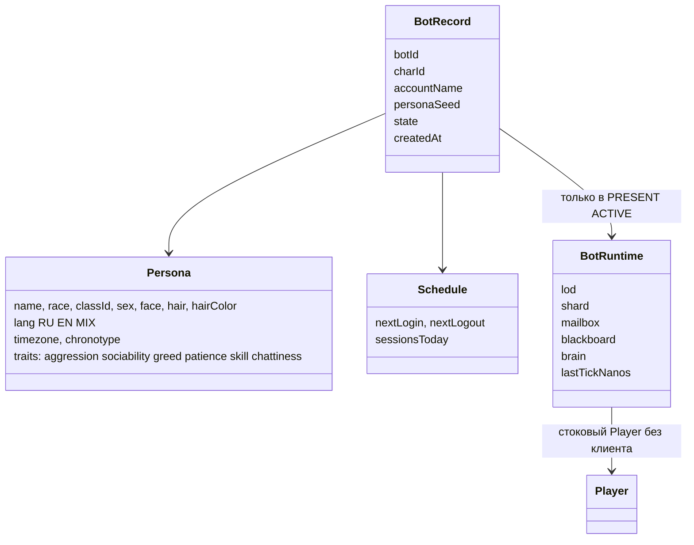
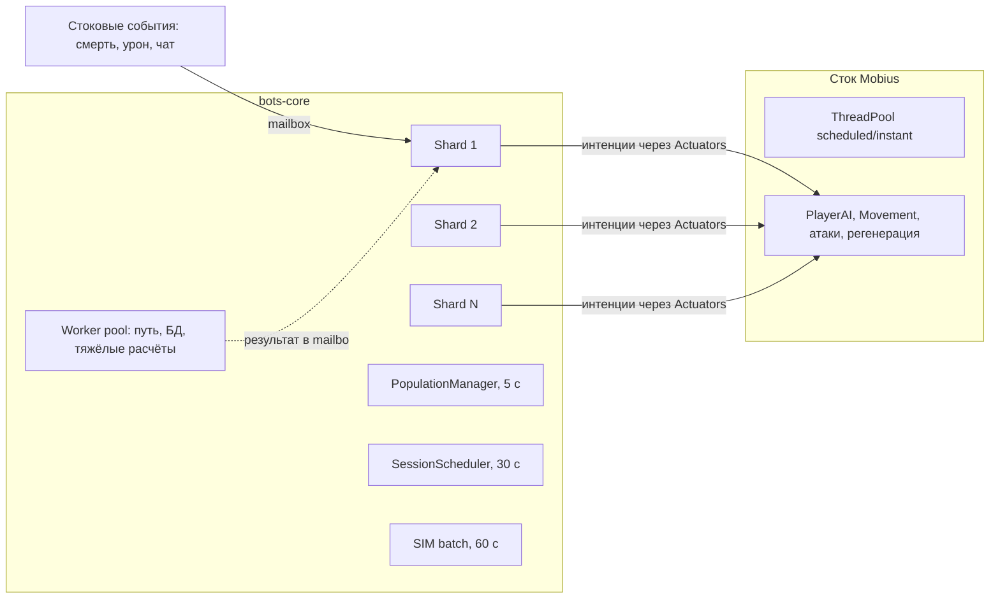
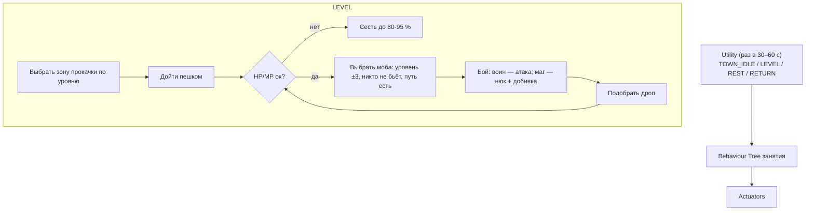

# Фаза 3: ядро ботов (`bots-core`). План на утверждение

*Только план, кода нет. Ветка будет `phase3` в `F:\l2start-server`, PR в `main`. База: `main` = `3573ffc7` (фазы 0–2 влиты).*

Обозначения: ✅ проверено (код, файл, замер), 💡 предложение, 📏 оценка, которую надо подтвердить замером.

---

## 0. Коротко

- **Цель фазы 3** — каркас, на котором фазы 4–7 построят охоту, город, торговлю, пати и PvP. Это не «умные боты», а **надёжное тело, жизненный цикл и рантайм** плюс минимальный мозг, который доказывает, что цикл «расписание → вход → LOD → тик → действие → прогресс → выход» работает.
- **Бот — настоящий стоковый `Player` без клиента**, на **своём** бот-аккаунте (1 бот = 1 аккаунт), с защитой от входа через логин (аккаунт помечен банном `accessLevel = -1`, пароль случайный). Отдельного `Player`-поля не нужно: признак `isBot` живёт в реестре платформы.
- **Два модуля:** `bots-core` (jar: сущность, хранение, персоны, расписание, LOD и бюджеты, шардированный тикер, Action/World API, админка, метрики) и `bots-brain-basic` (jar: минимальный мозг «город + прокачка у спота»). Мозг ходит в мир только через API `bots-core`, поэтому его тесты идут без сервера.
- **Хуков в ядре всего 2 новых** (`P3-BOT-CHARINFO`, `P3-BOT-WHISPER`), оба 1–2 строки. Остальное — стоковые события Mobius и реестр в платформе (API 1.1.0 → **1.2.0**).
- **Геодата обязательна для ботов.** ✅ На E: геодаты нет (только `Readme.txt`), в LW она есть: **166 регионов `.l2j`, 548 МБ** (`E:\L2-Living-Worlds\L2J_Mobius_CT_0_Interlude github\dist\game\data\geodata`), формат стоковый для Mobius CT0. Монтируем её через уже существующий `L2S_GEODATA_DIR`. Главный вопрос — память: см. §11 и вопрос 1.
- **Видимость:** ✅ у `Player` без клиента `isOnlineInt() == 0`, поэтому в БД `characters.online = 0`, и в счётчик сайта бот **по умолчанию не попадает** без всяких хуков. В игре бот выглядит как обычный игрок.
- **Оценка:** 📏 **~22–27 рабочих дней** агента (L), шесть подшагов 3a–3f, **5 контрольных точек** с тестом Глеба в клиенте.

---

## 1. Исходные данные (проверено)

### 1.1 Как сделаны боты сейчас

| Где | Как создаётся тело | Аккаунт | Чем управляется | Что берём |
|---|---|---|---|---|
| ✅ E: `virtualplayer/` (99 файлов) | `VirtualPlayerFactory`: `Player.create(...)` или `Player.load(charId)`, `setOnlineStatus(true,true)`, `spawnMe(...)`; клиента нет | **один общий** `VirtualPlayersConfig.ACCOUNT_NAME`, создаётся вставкой в `accounts` | свой `VirtualPlayerManager.ThinkTask`, brain/blackboard/FSM ролей, интенции стокового AI | паттерн тика и интенций; роли и бой — фаза 4 |
| ✅ E: `pvpbots/` (9 файлов) | `PvpBotFactory`, тот же принцип | свой | `PvpBotController` | `PvpBotGear` — фаза 7 |
| ✅ E: `FakePlayerStore*` | NPC, не `Player` | — | хуки в пакетах лавок | фаза 5 (боты в стоковых лавках) |
| ✅ LW `PhantomManager` (8 тыс. стр.) | `Player` без клиента | общие `phantom`, `phantom_regular`, `phantom_noble` | **стоковый AutoPlay** (`EnableAutoPlay=True` обязателен) | `FakePlayerNameFactory` (+тест), `FakePlayerAppearanceFactory` как образец |
| ✅ Mobius `OfflineTraderTable` | `Player.load` → `setOnlineStatus` → `spawnMe` → `restoreEffects` → `broadcastUserInfo` | — | — | **эталон стокового входа без клиента** |

Вывод: все три источника делают то же самое — `Player` без клиента. Это рабочий путь (на нём же стоковые офлайн-лавки и offline play). Проблемы у них не в теле, а в том, что признак бота размазан по ядру (общие аккаунты, `isFakePlayer`, `getClient()!=null`, исключения в Party/AutoPlay).

### 1.2 Что стоковое ядро делает с `Player` без клиента (✅ аудит `9fb01cb205`)

`getClient()` используется в **79 файлах (114 мест)**, проверки `isOnlineInt()==0` / `isInOfflineMode()` — в **15 местах**. Важное:

| Место | Что происходит с ботом | Решение в фазе 3 |
|---|---|---|
| `Player.broadcastCharInfo()` (стр. 4197): `if (isOnlineInt() == 0) return;` | **Бот перестаёт рассылать CharInfo**: смена оружия, брони, «сел/встал», цвет имени не видны игрокам рядом | **хук `P3-BOT-CHARINFO`** (§7) |
| `ChatWhisper.handleChat` (стр. 102): `receiver.getClient()==null` → «Player is in offline mode.» | **Шёпот боту выдаёт бота** | **хук `P3-BOT-WHISPER`** (§7) |
| `Player.isOnlineInt()` → 0 | в БД `characters.online = 0`; сайт и логин-сервер ботов не видят | **так и оставляем** (это и есть «скрыть от счётчика сайта») |
| `LoginServerThread` (стр. 299) | аккаунт бота не сообщается логину как «в игре» | ок |
| `AdminOnline` / `AdminEditChar` | GM видит ботов как «offline mode» (серым) | ок, это даже удобно; у GM есть `//bots` |
| `ClanMember.isOnline()` | в клане бот «офлайн» | фаза 7 (кланы) |
| `AutoUseTaskManager`, `AutoPlayTaskManager`, `AutoPotionTaskManager` | для бота не работают | не нужны: бот действует через Action API |
| `ItemManaTaskManager` | у бота не тратится мана шэдоу-предметов | фаза 4 (шэдоу у ботов не выдаём) |
| `PcCafePointsManager`, `PrecautionaryRestartManager`, `AntiFeedManager` | пропускают бота | ок |
| `RequestJoinParty`, трейд, клан, дуэль | заявка боту висит до таймаута (как у AFK-игрока) | фаза 5–6 (хук H10 «заявка без клиента») |
| `Player.sendPacket` | пакеты боту молча отбрасываются | ок: бот получает события через стоковый `EventDispatcher` и mailbox |

Остальные ~100 мест `getClient()` — пакеты-обработчики (вызываются только от клиента) или с проверкой на `null`. 💡 В 3a — полный аудит со списком в `docs/BOTS_CLIENTLESS.md` и smoke-сценарием «бот прожил 10 минут без исключений в логе».

### 1.3 Создание персонажа

✅ Стоковое создание (`CharacterCreate.initNewChar`, private в пакете): стартовая точка шаблона класса, стартовая адена, стартовый уровень и SP из конфига, **`InitialEquipmentData`** (значит, модуль `starter-kit` автоматически даёт ботам тот же стартовый сет), доступные скиллы, ярлыки, туториал, событие `ON_PLAYER_CREATE`. `bots-core` повторяет эту последовательность через публичные методы (без хука) и покрывает это тестом «бот и человек одного класса получают одинаковый инвентарь и скиллы».

### 1.4 Логин, БД, имена

- ✅ `LoginController` (стр. 278): `accessLevel < 0` → `ACCOUNT_BANNED`. Боты через логин не ходят вообще (тело поднимает игровой сервер), поэтому **бан-флаг защищает бот-аккаунт без хука**.
- ✅ Логин и гейм в Docker используют одну БД `l2start`, таблица `accounts` общая.
- ✅ `CnameTemplate = .*` (сток), `ForbiddenNames = annou,...`. Клиент Interlude принимает латиницу и цифры до 16 символов, поэтому «RU-стиль» = транслит.
- ✅ `OnPlayerChat(player, target, text, type)` — стоковое событие, у шёпота `target` заполнен. Через него бот получает шёпот, пати-чат и общий чат без хуков в пакетах.

### 1.5 Геодата

- ✅ E:\L2J_Mobius_CT_0_Interlude: `data/geodata` пуст (только `Readme.txt`), `PathFinding = 2`. Значит, твой текущий сервер **работает без геодаты** (мобы и боты ходят сквозь стены).
- ✅ LW: коммит `2a16d163` «Geodata» (2026-07-21), **166 файлов `XX_YY.l2j`, 548 МБ**, плюс `geo_index.txt`. На ПК лежит в `E:\L2-Living-Worlds\L2J_Mobius_CT_0_Interlude github\dist\game\data\geodata` и копией в `E:\L2-Living-Worlds\fpc data\geodata`. Размер файла 192 КБ–16 МБ.
- ✅ Формат совместим: Mobius CT0 ищет `GeoEngineConfig.GEODATA_PATH/%d_%d.l2j` (`GeoEngine.FILE_NAME_FORMAT`), LW — та же ветка Mobius CT0.
- ✅ Все стартовые деревни и города покрыты: Talking Island `17_25`, Elven `21_19`, Dark Elf `20_18`, Orc `18_14`, Dwarven `23_12`, Gludin `17_22`, Gludio `19_21`, Dion `20_22`, Giran `22_22`.
- ✅ Загрузка: файл мапится (`FileChannel.map`), затем `Region` разбирает его в объекты `FlatBlock`/`ComplexBlock`/`MultilayerBlock` **в куче Java**. 📏 Это ~0,6–0,9 ГБ кучи на полную геодату (LW в своём compose пишет «live heap после старта ~1,9 ГБ с геодатой»).
- ✅ Docker у тебя уже готов: `docker-compose.yml` монтирует `${L2S_GEODATA_DIR:-./geodata.empty}` в `/opt/l2/game/data/geodata:ro`, `entrypoint.sh` пишет в лог число файлов.

### 1.6 Ресурсы ПК (замер сейчас, сервер `solo` без ботов и геодаты)

✅ Ryzen 5 2600 (6 ядер / 12 потоков), RAM 7,93 ГБ, Docker `MemTotal` 3,79 ГиБ, 12 CPU. `l2s-game` 1,58 ГиБ RSS (ZGC: used 1000 МБ, capacity 1348 МБ, max 2048 МБ), `l2s-login` 170 МБ, `l2s-db` 106 МБ. Итого ~1,86 ГиБ из 3,79.

---

## 2. Что входит и что НЕ входит в фазу 3

**Входит:**
1. Модель сущности бота: бот-аккаунт, создание, вход, выход, смерть и воскрешение, сохранение. Реестр `isBot` в платформе.
2. Хранение: таблицы `bot_*` через миграции модуля.
3. Генератор персон: имя RU/EN, раса, класс, пол и внешность по распределению, черты, хронотип, часовой пояс, язык.
4. Планировщик сессий: вход и выход «как у людей», часовые пояса, суточная кривая онлайна.
5. Population manager: уровни LOD `OFFLINE / SIMULATED / PRESENT / ACTIVE`, бюджеты, гистерезис, деградация при перегрузе.
6. Рантайм: шардированный тикер с бюджетом времени, mailbox, worker pool.
7. **Action API** (move, attack, cast, use item, pick up, sit/stand, target, chat, revive-to-town, logout) и **World API** (снимок мира вокруг бота). Фейковый мир для оффлайн-тестов мозгов.
8. Минимальный мозг: «гуляет и стоит в городе» + «качается на мобах у стартовой деревни» (выбор цели, бой воином или магом, сидит для регена, смерть → в город → назад).
9. Админка `//bots …`, метрики, лог раз в минуту, файл метрик.
10. Хуки `P3-BOT-CHARINFO`, `P3-BOT-WHISPER`; платформа API 1.2.0.
11. Геодата: подключение, проверка, правило «боты только в регионах с геодатой».
12. Нагрузочный тест на ПК (до 300 ботов) и отчёт.
13. Тесты: unit (персоны, расписание, LOD, бюджеты, BT/utility, мозг на фейковом мире), smoke (новый сценарий с ботами; сценарий «всё выключено = сток» остаётся зелёным), CI.

**НЕ входит (фазы 4–10):**
- Охота по спотам с резервированием, боевые роли и ротации (`virtualplayer`, playstyles LW), баффы, сосы, покупки, restock, SIMULATED-прогресс по таблицам — **фаза 4**. В фазе 3 SIMULATED только учитывает время.
- Торговля, лавки, WTS/WTB, рынок, хуки H7–H9 — **фаза 5**.
- Пати, друзья, ответы на шёпот, шаблоны чата, Humanizer, хуки заявок H10/H11, распределение XP в пати H14 — **фаза 6**. В фазе 3 бот **получает** шёпот в mailbox (не выдаёт себя), но не отвечает.
- PvP, карма, grudge, бот-кланы, клан-онлайн — **фаза 7**.
- 1000 ботов + 500 игроков на VPS — **фаза 8**. Олимпиада — 9. LLM — 10.
- Старые системы `virtualplayer`, `pvpbots`, `FakePlayerStore`, фантомы LW в сборку **не переносим** (только как образец кода).
- Изменения стоковых механик и рейтов: нет (x1, сток).

---

## 3. Модули и раскладка

```
modules/
  bots-core/                 kind=jar, platform ^1.2
    module.json
    MODULE.md
    config/defaults.ini
    sql/V1__bots_core.sql   (+ V2… по мере надобности)
    data/html/...           (страницы //bots)
    data/names/             (словари имён RU/EN, распределения классов)
    src/org/l2start/bots/
      api/        публичный API для мозгов: Bot, BotBrain, WorldView, Actuators, BotClock, Blackboard
      core/       BotService, BotRegistryImpl, BotFactory (создание), BotSession (вход/выход), BotRecord
      persona/    PersonaGenerator, NameGenerator, ClassDistribution, Appearance
      schedule/   SessionScheduler, Chronotype, OnlineCurve
      population/ PopulationManager, Lod, Budgets, InterestMap
      runtime/    ShardedTicker, Shard, Mailbox, WorkerPool
      world/      MobiusWorldView (снимок), MobiusActuators (адаптер к стоковому AI)
      store/      BotRepository (DAO таблиц bot_*)
      admin/      AdminBots (//bots)
      metrics/    BotMetrics
    test/         unit + testFixtures (FakeWorld, FakeActuators, ManualClock)
  bots-brain-basic/          kind=jar, depends bots-core ^1.0
    src/org/l2start/bots/brain/basic/
      BasicBrain (Utility: TOWN_IDLE / LEVEL / REST / RETURN)
      bt/ (Sequence, Selector, Condition, Action, Cooldown)
      town/ (WanderInTown)
      level/ (PickTarget, Fight, Loot, Rest, DeathRecovery, LearnSkills)
    test/   тесты мозга на FakeWorld без сервера
```

Почему два модуля: так с первого дня проверяется, что мозг — подключаемая часть. Фаза 4 добавит `bots-hunting` рядом, а `bots-brain-basic` можно будет выключить.

**Профили по умолчанию** 💡: `bots-core` и `bots-brain-basic` **включены в `solo`, выключены в `online`** до фазы 8. В `solo` стартовый потолок `MaxOnline = 150`, после нагрузочного теста — до 300.

---

## 4. Модель сущности бота

### 4.1 Объекты



- `BotRecord` всегда в памяти (лёгкий, ~1 КБ на бота: 1000 ботов ≈ 1 МБ).
- `Player` существует **только** в PRESENT/ACTIVE. В OFFLINE/SIMULATED бот — строка в БД плюс `BotRecord`.

### 4.2 Аккаунты и защита входа

- 💡 **1 бот = 1 аккаунт**, как у живых. Имя аккаунта случайное, не связанное с ником (`b` + 10 символов base32), пароль — 32 случайных байта, в `accounts.password` кладётся хеш (стоковый SHA1-base64 Mobius), исходник нигде не хранится.
- `accounts.accessLevel = -1` → логин отвечает «аккаунт заблокирован» (✅ `LoginController` стр. 278). **Хук в логине не нужен.** Боту это не мешает: он не ходит через логин.
- Таблица `bot_account` перечисляет бот-аккаунты. Платформа при старте сверяет: у каждого бот-аккаунта `accessLevel < 0`; если кто-то снял бан руками — модуль ставит обратно и пишет WARNING.
- Защита от путаницы с живыми: `bots-core` **никогда** не трогает аккаунты и персонажей, которых нет в `bot_account` / `bot_identity` (урок LW: `rebindAccount` в E: переписывал `account_name`).
- Персонаж бота с `accesslevel = 0` (обычный игрок). GM-права ботам невозможны: модуль это проверяет.

### 4.3 Жизненный цикл тела

| Шаг | Что делает `bots-core` | Стоковый эталон |
|---|---|---|
| Создание | аккаунт → `Player.create(template, account, name, appearance)` → шаги `initNewChar` (точка шаблона, адена/уровень/SP из конфига, `InitialEquipmentData`, скиллы, ярлыки, `ON_PLAYER_CREATE`) → `storeMe` → `deleteMe` (как в стоке после создания) | ✅ `CharacterCreate.initNewChar` |
| Вход (→ PRESENT) | `Player.load(charId)` → регистрация в `BotRegistry` **до** спавна → `setOnlineStatus(true,false)` → `spawnMe(x,y,z)` → `restoreEffects()` → `onPlayerEnter()` (стоковые `ON_PLAYER_LOGIN`-слушатели) → `broadcastUserInfo()` | ✅ `OfflineTraderTable` |
| Тик | только шард бота, через Action API | — |
| Смерть | событие `ON_CREATURE_DEATH` → mailbox → мозг ждёт 5–40 с (как человек) → «В деревню» = стоковый `teleToLocation(TeleportWhereType.TOWN)` + `doRevive()` | ✅ поведение кнопки «To Village» |
| Выход (→ SIMULATED/OFFLINE) | бот не в бою (ждёт до 30 с, как стоковый запрет выхода в бою) → `storeMe()` → `deleteMe()` → снятие с реестра | ✅ `Disconnection.storeAndDelete` |
| Остановка сервера | `onShutdown` модуля (хук `P1-SHUTDOWN` фазы 1) выводит всех ботов **до** стокового сохранения игроков, с лимитом времени | ✅ уже есть |
| Удаление | `//bots purge <name>`: стоковый `GameClient.deleteCharByObjId(objectId)` + строка `accounts` + строки `bot_*`. Только для ботов из `bot_identity` | ✅ стоковое удаление |

### 4.4 `isBot` и видимость

- 💡 В платформе (не в `Player`): `org.l2start.platform.api.BotPresence` с методом `isBot(Player)` и `CoreHooks.isBot(Player)`. Реализация — `BotRegistryImpl` в `bots-core` (`ConcurrentHashMap<Integer, Bot>` по objectId, `O(1)`). Пока модуль выключен, `isBot()` всегда `false` (сток не меняется). Это замена `isFakePlayer`, `isBuddyBot`, проверок аккаунтов `virtual_players` / `phantom*` из старых систем.
- **Счётчик онлайна:**
  - сайт: ✅ у бота `characters.online = 0`, значит, запрос сайта вида `WHERE online > 0` ботов не видит. **По умолчанию скрыты, хук не нужен.** (Проверить точный запрос сайта — вопрос 3.)
  - логин-сервер (нагрузка в списке серверов): ✅ ботов не учитывает.
  - `//online` у GM: ботов показывает как «offline» (серым), а `//bots` — отдельно.
  - 💡 Ключ `Visibility.CountInOnline = false`. Если позже захочешь показывать ботов в онлайне, понадобится policy-хук (H21 из архитектуры), в фазе 3 его не делаем.
- **В игре** бот выглядит как обычный игрок: ник, титул, CharInfo, шёпот принимается (не «offline mode»). На шёпот в фазе 3 бот молчит (как занятый игрок), ответы — фаза 6.

---

## 5. Хранение (миграции `bots-core`)

`sql/V1__bots_core.sql` (InnoDB, utf8mb4; ownership таблиц `bot_*` у модуля, как в фазе 1):

| Таблица | Поля | Зачем |
|---|---|---|
| `bot_account` | `account_name` PK, `created_at` | список бот-аккаунтов, проверка бана |
| `bot_identity` | `bot_id` PK auto, `char_id` UNIQUE, `account_name`, `status` (`ACTIVE`/`RETIRED`), `persona_version`, `created_at` | связь бота с персонажем |
| `bot_persona` | `bot_id` PK, `seed` BIGINT, `data` TEXT (JSON: язык, черты, хронотип, tz, стиль) | постоянный характер |
| `bot_schedule` | `bot_id` PK, `timezone`, `chronotype`, `next_login`, `next_logout`, `last_login`, `last_logout`, `day_plan` TEXT (JSON) | расписание |
| `bot_state` | `bot_id` PK, `lod`, `goal`, `home_x/y/z` (зона прокачки), `updated_at` | восстановление после рестарта |
| `bot_stats_daily` | `bot_id`, `day`, `online_sec`, `active_sec`, `kills`, `deaths`, `exp_gained`, `adena_gained` (PK `bot_id, day`) | контроль «прогресс как у людей» и отчёт нагрузочного теста; чистка старше 30 дней |

- Стоковые таблицы (`characters`, `items`, `character_skills`, …) бот использует как обычный игрок.
- Таблицы памяти (`bot_memory`), спотов, рынка — миграциями в фазах 4–6.
- Запись батчами из worker pool (не из шарда), раз в 60 с и при выходе.

---

## 6. Персоны (генератор)

Детерминированный: `seed` → одна и та же персона (воспроизводимо в тестах и после пересоздания).

### 6.1 Имена

- Стили (💡 доли по умолчанию, ключ `Persona.NameStyles`):
  - RU-транслит 35 %: `Vasyan`, `Dimon4ik`, `Kotyara`, `Serega`, `Zlobnyi`, `Lexa1987`;
  - EN-обычные и игровые 30 %: `Ironwolf`, `Shadowstep`, `Kira`, `Nightfall`;
  - фэнтези (слоги, близко к LW `FakePlayerNameFactory`) 20 %: `Aelrin`, `Morvath`, `Tharok`;
  - «геймерские» 15 %: `xXSlayerXx`, `DarkLord777`, `ProHealer`, `NeKiLlMe`.
- Правила: 3–16 символов, `[A-Za-z0-9]`, без повторов 3+ одинаковых букв подряд (кроме `xX`), стоп-лист (мат RU/EN, `GM`, `Admin`, `Bot`, `Support`, стоковые `ForbiddenNames`), проверка уникальности через стоковый `CharInfoTable` и в пределах пачки.
- Стиль ника и язык связаны: у RU-транслита язык RU, у EN — EN/MIX.
- Словари в `data/names/*.txt` (их можно править без пересборки).

### 6.2 Раса, класс, внешность

- В фазе 3 только 9 стартовых классов (боты стартуют с 1 уровня, как люди). 💡 Распределение по умолчанию (`Persona.ClassWeights`, похоже на живой Interlude: много спойлеров/гномов, магов-эльфов и тёмных):

| Класс | Доля | | Класс | Доля |
|---|---|---|---|---|
| Human Fighter (0) | 15 % | | Dark Fighter (31) | 11 % |
| Human Mystic (10) | 12 % | | Dark Mystic (38) | 10 % |
| Elven Fighter (18) | 9 % | | Orc Fighter (44) | 9 % |
| Elven Mystic (25) | 10 % | | Orc Mystic (49) | 6 % |
| | | | Dwarven Fighter (53) | 18 % |

- Пол, лицо, причёска, цвет — стоковые диапазоны шаблона, с весами (у некоторых рас/полов чаще выбирают определённые причёски; веса в конфиге, образец — LW `FakePlayerAppearanceFactory`).
- Будущая профессия (BH/WL/SE/…) выбирается при генерации и хранится в персоне, но смена профессии — фаза 4.

### 6.3 Черты и стиль

- Черты 0–1 (нормальное распределение, обрезка): агрессия, общительность, жадность, терпение, «скилл» (время реакции 200–1200 мс), болтливость. В фазе 3 используются только «скилл» (задержки реакции) и терпение (как долго сидит на регене).
- Хронотип: `EVENING` (будни 18–01), `NIGHT_OWL` (21–04), `WEEKEND` (сб–вс днём), `ALLDAY` (безработный/студент), `MORNING`. Доли в конфиге.
- Часовой пояс: 💡 `solo` — пояс ПК (`Europe/Moscow`). `online` — распределение `Schedule.TimezoneWeights`, по умолчанию MSK 70 %, UTC+2 (Калининград/Киев) 8 %, UTC+5…+7 (Урал/Сибирь) 15 %, прочие 7 % (вопрос 5).

---

## 7. Хуки в ядре (точные места)

Правила `check-hooks` фазы 1 сохраняются: только добавления, метка `[HOOK:id]` или блок `>>>`/`<<<`, запись в `docs/PLATFORM_HOOKS.md`. Пока `bots-core` выключен, оба хука инертны: `CoreHooks.isBot()` возвращает `false`.

| Id | Файл | Место | Вставка | Почему нельзя без хука |
|---|---|---|---|---|
| `P3-BOT-CHARINFO` | `core/java/org/l2jmobius/gameserver/entity/actor/Player.java` | метод `broadcastCharInfo()`, **перед** строкой `if (isOnlineInt() == 0)` (сейчас стр. 4197) | блок `>>>`: `if (!org.l2start.platform.hooks.CoreHooks.isBot(this))` — guard-префикс, который делает стоковую проверку «клиент отключён» неприменимой к ботам | без него игроки не видят смену экипировки, посадку, титул бота; обойти событиями нельзя |
| `P3-BOT-WHISPER` | `core/dist/game/data/scripts/handlers/chat/channels/ChatWhisper.java` | метод `handleChat`, **перед** `if ((receiver.getClient() == null) \|\| receiver.getClient().isDetached())` (сейчас стр. 102) | такой же guard-префикс: для бота стоковая ветка «Player is in offline mode.» пропускается, дальше идёт стоковая доставка (отправителю эхо `->Ник`, боту `CreatureSay` уходит в никуда), а текст боту приходит через стоковое `ON_PLAYER_CHAT` | иначе шёпот выдаёт бота |

Что **не** требует хука (✅ проверено):
- защита входа — бан `accessLevel = -1`;
- скрытие из счётчика сайта — `online = 0` у `Player` без клиента;
- создание персонажа — публичные методы `Player`, `InitialEquipmentData`, `SkillTreeData`, `InitialShortcutData`;
- события боя, смерти, чата, левел-апа — стоковый `EventDispatcher` (`ON_CREATURE_DEATH`, `ON_CREATURE_DAMAGE_RECEIVED`, `ON_CREATURE_ATTACKED`, `ON_PLAYER_CHAT`, `ON_PLAYER_LEVEL_CHANGED`, `ON_CREATURE_ZONE_ENTER`);
- выход ботов при остановке — `P1-SHUTDOWN`;
- админ-команды — `ctx.handlers()`.

**Платформа** (`platform/`, не ядро): `CoreHooks.isBot(Player)`, интерфейс `BotPresence` в `ServiceRegistry`, `Platform.API_VERSION` → **1.2.0** (новый API, старые модули `^1.0`/`^1.1` совместимы). Смок-фикстура `fx-core` проверяет, что без `bots-core` `isBot` всегда `false`.

Итого после фазы 3: **12 хуков** (было 10). Хуки из архитектуры H6, H7–H9, H10–H11, H12–H17, H21 переносятся в фазы 5–7, где появляются их потребители.

---

## 8. Рантайм: потоки и тик

### 8.1 Шардированный тикер



- 💡 **Шарды:** `N = max(2, cores / 4)`, на ПК (12 потоков) → 3, на VPS 8 vCPU → 2–3. Ключ `Runtime.Shards` (0 = авто). Бот закреплён за шардом по `botId % N`.
- **Волна** каждые `Runtime.WaveMs = 100` мс. Шард обходит своих ботов, у которых наступило `nextTickAt`, с **бюджетом** `Runtime.WaveBudgetMs = 25` мс. Кто не успел, переходит в следующую волну (счётчик `overrun`). Никаких `ScheduledFuture` на бота (паттерн стокового `AutoPlayTaskManager` и `VirtualPlayerManager.ThinkTask` с E:).
- **Частота тика по LOD:** ACTIVE в бою 300 мс, ACTIVE вне боя 1 с, PRESENT 3–5 с (с джиттером, чтобы боты не тикали синхронно). SIMULATED тикают раз в 60 с пакетом, не в шарде.
- **Однопоточность бота:** состояние бота меняет только его шард. События стокового движка (из чужих потоков) кладутся в `Mailbox` (MPSC-очередь, лимит 64, старые события схлопываются) и разбираются в начале тика.
- **Worker pool** (2 потока, ограниченная очередь): длинный путь по геодате, запись в БД, генерация персон. Результат возвращается в mailbox.
- **Действия** выполняются стоковыми интенциями AI (`setIntention(MOVE_TO/ATTACK/CAST/PICK_UP)`, `useItem`, `sitDown`) — как у человека, потокобезопасность обеспечивает стоковый AI.
- **Защита:** исключение в мозге одного бота → бот уходит в `SAFE_IDLE` на 60 с и пишется в лог (с ограничением частоты). 10 исключений за 10 мин → бот выводится из мира (`//bots info` покажет причину). Шард никогда не падает целиком.

### 8.2 Population manager и LOD

| LOD | В мире | Мозг | Тик | Когда |
|---|---|---|---|---|
| `OFFLINE` | нет | нет | — | вне сессии по расписанию |
| `SIMULATED` | нет | нет | 60 с, пакет | в сессии, но рядом нет живых, и не хватает бюджета PRESENT |
| `PRESENT` | да | лёгкий (город: стоять, сидеть, ходить; на споте — «отдых») | 3–5 с | в сессии, бюджет есть, живых рядом нет |
| `ACTIVE` | да | полный | 0,3–1 с | живой игрок ближе `PromoteRadius`, или бот выбран для «живой» зоны |

- **Каждые 5 с** PM строит карту интереса: позиции живых (не-ботов) игроков → ячейки 2048×2048. Бот в ячейке рядом с живым → кандидат в ACTIVE.
- **Гистерезис:** повышение при ≤ 3000, понижение при > 4500 и только через 45 с. Нет «мигания».
- **Приоритет на ACTIVE** при нехватке бюджета: (1) живой игрок ближе 1500, (2) ближе 3000, (3) остальные по времени ожидания.
- **Вход в мир «естественно»:** SIMULATED → PRESENT происходит как обычный логин (персонаж просто появляется в последней точке выхода или в городе). Это нормально для L2: живые тоже «появляются» при входе. Внутри одной сессии бот не прыгает между SIMULATED и PRESENT на глазах у игроков: понижение в SIMULATED только если в радиусе 4500 нет живых.
- **Бюджеты** (💡 стартовые, уточнить нагрузочным тестом):

| Ключ | `solo` | `online` (до фазы 8 выключено) |
|---|---|---|
| `Budget.MaxOnline` (все кроме OFFLINE) | 150 → 300 после теста | 1000 |
| `Budget.MaxPresent` (PRESENT + ACTIVE в мире) | 150 | 750 |
| `Budget.MaxActive` | 60 → 100 | 400 |
| `Budget.CpuShare` (доля времени шардов от wall-clock × ядра) | ≤ 40 % | ≤ 30 % |
| `Runtime.WaveBudgetMs` | 25 | 25 |

- **Деградация при перегрузе** (overrun > 10 % волн за 30 с или p99 тика > бюджета): (1) ACTIVE дальше 2500 от живых тикают в 2 раза реже, (2) часть ACTIVE → PRESENT, (3) часть PRESENT → SIMULATED (только вне видимости живых), (4) пауза новых входов. Каждый шаг пишется в лог и метрики, откат через 2 мин нормальной работы.
- **Геодата-гейт:** бот входит в мир и получает точки движения только в регионах, где `GeoEngine.hasGeo(x, y)` (✅ API стока). Если геодаты нет вообще (`PathFinding` автоматически выключается стоком), боты не спавнятся в мир, `bots-core` пишет WARNING и работает в режиме SIMULATED-only. Ключ `World.RequireGeodata = true`.

### 8.3 Планировщик сессий

- Раз в сутки (и при создании бота) строится план на 48 ч: число сессий, начало, длительность, пропуски.
- 💡 Модель: из хронотипа берётся «окно активности» в локальном времени бота; старт сессии ~ окно + нормальный шум ±40 мин; длительность — лог-нормальная, медиана 90 мин (ALLDAY 180), минимум 10 мин («зашёл на 10 минут»); вероятность пропустить день 10–30 % (по хронотипу); выходные длиннее.
- **Суточная кривая онлайна:** сумма сессий ботов должна повторять кривую `Schedule.OnlineCurve` (24 значения, по умолчанию пик 20–23 MSK, минимум 05–08). Если ботов в сессии больше, чем позволяет `MaxOnline × curve(hour)`, планировщик сдвигает или укорачивает сессии наименее «приоритетных» (стабильно по seed, чтобы одни и те же боты не страдали всегда).
- Выход: по плану, но не в бою и не при живом игроке «в контакте» (бот бьёт моба рядом с игроком → доигрывает до 5 мин).
- Время инжектируется (`BotClock`), поэтому весь планировщик тестируется на «ускоренных сутках» в unit-тестах.
- В `solo` по умолчанию `Schedule.Mode = SCHEDULED`; есть `ALWAYS` (все боты в сессии, для тестов) и `MANUAL` (только `//bots spawn`).

---

## 9. Action API и World API

Публичный пакет `org.l2start.bots.api` **без импортов Mobius** (только простые record-типы). Это главное условие оффлайн-тестов мозгов.

### 9.1 World API (снимок)

`WorldView` строится шардом в начале тика (радиус `World.ViewRadius = 1500`, максимум 64 объекта, ближайшие первыми):

- `Self`: objectId, имя, класс, уровень, exp%, HP/MP/CP (абс. и %), позиция, heading, сидит/бежит/мёртв/в бою, вес%, текущая цель, кастует ли, откаты скиллов, известные скиллы (id, уровень, тип: атака/бафф/хил, дальность, MP), важные предметы (сосы, банки, стрелы — количество).
- `Npc`: objectId, npcId, имя, уровень, HP%, позиция, дистанция, агрессивный ли, атакуем ли, кого бьёт, кто его бьёт (ksteal-проверка), это моб/NPC/рейд.
- `PlayerSeen`: objectId, имя, уровень, класс, позиция, карма, pvp-флаг, в бою ли, цель, `isBot` (**только для мозга**, наружу не утекает), клан.
- `DropSeen`: предметы на земле, чей дроп и сколько секунд он защищён.
- `Zone`: мирная/город/PvP, есть ли геодата, ближайший город (`TeleportWhereType.TOWN`).
- `Geo`: `canSeeTarget(a, b)`, `canMoveTo(a, b)`, `randomReachablePoint(center, radius)` (из worker pool, кэшируется).
- События с прошлого тика (из mailbox): меня ударили, цель умерла, я умер, левел-ап, шёпот/чат мне, пришли куда шли, движение прервано.

### 9.2 Actuators (действия)

| Метод | Сток под капотом | Примечание |
|---|---|---|
| `moveTo(x,y,z)` | `getAI().setIntention(MOVE_TO)` + геодата | точка проверяется `canMoveTo`; длинный путь — по отрезкам |
| `follow(objectId)` | `setIntention(FOLLOW)` | |
| `setTarget(objectId)` | `setTarget` | |
| `attack(objectId)` | `setIntention(ATTACK)` | только если `isAutoAttackable` по стоку |
| `cast(skillId, objectId)` | `useMagic(skill, …)` | проверка отката и MP, стоковые условия |
| `useItem(itemObjectId)` | стоковый `useItem` (как двойной клик) | банки, сосы (включение autoshot — фаза 4) |
| `pickUp(dropObjectId)` | `setIntention(PICK_UP)` | |
| `sit()` / `stand()` | `sitDown` / `standUp` | |
| `say(channel, text)` | стоковая рассылка `CreatureSay` (ALL, SHOUT, TRADE, PARTY, WHISPER) | rate limit 6 фраз/мин на бота; в фазе 3 только для админ-проверки (`//bots say`) |
| `returnToTown()` | `teleToLocation(TOWN)` + `doRevive()` для мёртвого | |
| `learnSkills()` | стоковый `SkillTreeData.getAvailableSkills` с оплатой SP | упрощение до фазы 4 (вопрос 7) |
| `logout()` | выход по §4.3 | |

Каждое действие проходит **валидатор** (дистанция, жив ли, мирная зона, геодата, бот ли это вообще), возвращает `ActionResult` (`OK`, `INVALID`, `COOLDOWN`, `NOT_REACHABLE`), и учитывается в метриках. «Задержка реакции» персоны применяется здесь: действие ставится не раньше чем через 200–1200 мс после события.

### 9.3 Оффлайн-тесты

`testFixtures` `bots-core`: `FakeWorld` (сетка, мобы с HP и уроном, игроки, дроп, простая «геодата» из прямоугольников), `RecordingActuators`, `ManualClock`. Мозг гоняется на тысячах тиков в JUnit за секунды: «бот 1 уровня в деревне → находит моба → убивает → садится на реген → умирает и возвращается → набирает опыт».

---

## 10. Минимальный мозг (`bots-brain-basic`)

Цель — доказать цикл, а не реализм боя.



- **TOWN_IDLE:** ходит между случайными точками города (по геодате), стоит 20–120 с, иногда садится. После входа в игру 30 % ботов сначала «тупят» в городе 1–5 мин.
- **LEVEL:** зоны прокачки на старте — 💡 вокруг 5 стартовых деревень, координаты из стоковых спавнов мобов 1–15 уровня (таблица `data/levelzones.xml` в модуле, ~15 зон). Моб: `level ∈ [lvl−3, lvl+2]`, не агрессивный для бота 1–5 уровня, никто его не бьёт (без kill-steal), до него есть путь.
- **Бой:** воин — `attack`. Маг — первый атакующий магический скилл из стокового дерева своего класса (у мистиков 1 уровня это Wind Strike 1177; точный список по 4 мистикам сверим в 3d по `SkillTreeData`), при MP < 20 % — атака посохом или реген. Банок, сосов и баффов в фазе 3 нет.
- **REST:** HP < 45 % или MP < 30 % → сесть до 80–95 % (по черте «терпение»).
- **Смерть:** лежит 5–40 с → в город → снова LEVEL.
- **Прогресс:** при левел-апе `learnSkills()`. Цель проверки: бот за 2–3 часа онлайна выходит на уровни 8–12 (x1).
- **RETURN:** по сигналу расписания (скоро выход) идёт в город или выходит на месте.

Боевые роли, ротации, сосы, баффы, профы — фаза 4 (перенос из `virtualplayer` и playstyles LW).

---

## 11. Геодата: решение

| Вопрос | Решение 💡 |
|---|---|
| Источник | LW, 166 регионов `.l2j` (548 МБ). На ПК: `E:\L2-Living-Worlds\L2J_Mobius_CT_0_Interlude github\dist\game\data\geodata`. E: только читаем: копируем в `F:\l2start-data\geodata` (вне git) |
| Формат | ✅ стоковый L2J `.l2j` для Mobius CT0, `%d_%d.l2j`, `PathFinding = 2` (ячейки, сток по умолчанию) |
| Git | **Не кладём** (548 МБ, происхождение пака неясно). В репо: `docs/GEODATA.md` + `tools/geodata-manifest.txt` (имена, размеры, SHA-256) и `tools/check-geodata.sh/.ps1` (сверка) |
| Docker | `L2S_GEODATA_DIR=F:/l2start-data/geodata` в `docker/profiles/solo.env` (read-only bind, уже поддерживается). Для VPS — та же папка через rsync |
| Проверка | лог стока `GeoEngine: Loaded 166 regions.` + сверка манифеста; smoke в CI работает без геодаты (боты там в режиме `RequireGeodata=false` на крошечной тестовой зоне) |
| Память | 📏 +0,6–0,9 ГБ кучи. Замер в 3a: старт с полной геодатой, `jcmd GC.heap_info`, RSS контейнера |
| Влияние на игру | геодата включается **для всего сервера**: мобы перестают ходить сквозь стены, работает LOS для скиллов. Это стоковое поведение, но игра у тебя изменится (в лучшую сторону). Вопрос 2 |

**Память на ПК** — главный риск фазы. Сейчас Docker 3,79 ГиБ, занято ~1,86. Варианты:

| Вариант | Куча game | Итого Docker 📏 | Плюсы | Минусы |
|---|---|---|---|---|
| **A.** Полная геодата, Docker как есть | `-Xmx2560m`…`3g` | ~3,3–3,7 ГиБ из 3,79 | всё по стоку | впритык; при 300 ботах риск OOM-kill контейнера |
| **B.** Полная геодата, Docker (WSL) 5,5–6 ГБ | `-Xmx3g`…`3,5g` | ~3,7–4,2 из 5,5 | запас для 300 ботов | меньше RAM Windows и клиенту (7,9 ГБ на всё) |
| **C.** Частичная геодата в `solo` (только «бот-регионы»: 9 регионов городов и деревень из §1.5 + соседние, ~20–25 файлов, 📏 80–150 МБ) | `-Xmx2560m` | ~2,8–3,1 ГиБ | влезает в текущий Docker | вне этих регионов нет геодаты (как сейчас): мобы там ходят сквозь стены; боты туда не ходят (геодата-гейт) |

💡 Рекомендую: в 3a сделать замер A; если запас < 0,6 ГиБ, то для `solo` по умолчанию **C** (список регионов в `docker/profiles/solo.env`, `L2S_GEODATA_REGIONS=…`, entrypoint копирует/линкует только их), а **B** — если ты разрешишь поднять память Docker. Для `online` (VPS) всегда полная геодата. Сам лимит памяти Docker я менять не буду без твоего ответа.

Также: `solo` `-Xmx` поднимаем только в рамках решения выше; GC на `solo` остаётся ZGC (сток образа) — в 3f сравним с G1 по RSS (ZGC держит больший запас кучи).

---

## 12. Админка и метрики

### 12.1 Команды (только GM, стоковый `accessLevel` админа; у твоего `admin` 100)

| Команда | Что делает |
|---|---|
| `//bots` | сводка: всего, по LOD, бюджеты, шарды (p50/p99, overrun), режим деградации; HTML-окно с кнопками |
| `//bots list [lod\|zone\|class] [page]` | список с фильтрами, клики → `info` |
| `//bots info <name>` | персона, расписание (след. вход/выход), LOD, цель, узел BT, последние 10 действий и результаты, время тика, ошибки |
| `//bots create <n> [classId]` | сгенерировать n новых ботов (аккаунты, персонажи), не входя в мир |
| `//bots spawn <n\|name> [here\|town]` | ввести в мир (минуя расписание); `here` — рядом с GM (для тестов) |
| `//bots despawn <name\|all>` | корректный выход |
| `//bots promote\|demote <name>` | принудительно сменить LOD |
| `//bots goto <name>` | телепорт GM к боту |
| `//bots pause\|resume` | заморозить тикер (боты стоят) |
| `//bots mode scheduled\|always\|manual` | режим планировщика до рестарта |
| `//bots purge <name>\|retired` | удалить ботов (с подтверждением) |
| `//bots stats` | метрики за 1/5/15 мин |

### 12.2 Метрики (через `ctx.metrics()` платформы)

- Gauges: ботов по LOD, в сессии, в мире, ACTIVE рядом с живыми; размер очередей mailbox и worker pool.
- Таймеры: тик шарда p50/p95/p99/max, волна, доля CPU шардов, время построения `WorldView`, время пути.
- Счётчики: overrun, переходы LOD/мин, входы/выходы, смерти, убийства, опыт, ошибки мозга, отклонённые действия.
- Вывод: строка в лог раз в 60 с (`BOTS online=… active=… p99=… overrun=…`) и файл `game/log/metrics/bots.prom` (формат Prometheus, перезапись раз в 15 с, без сетевого эндпоинта — безопасно). Нагрузочный тест читает этот файл.
- JFR: инструкция в `docs/BOTS.md` (`jcmd 1 JFR.start duration=10m`).

---

## 13. Конфиг `bots-core` (`config/defaults.ini`, override через `L2_MOD_BOTS_CORE__KEY`)

| Ключ | `solo` | `online` | Смысл |
|---|---|---|---|
| `Schedule.Mode` | `SCHEDULED` | `SCHEDULED` | `SCHEDULED` / `ALWAYS` / `MANUAL` |
| `Population.TargetBots` | 150 | 1000 | сколько ботов создать (пул персон) |
| `Budget.MaxOnline` / `MaxPresent` / `MaxActive` | 150 / 150 / 60 | 1000 / 750 / 400 | §8.2 |
| `Budget.CpuShare` | 0.40 | 0.30 | |
| `Runtime.Shards` | 0 (авто) | 0 | |
| `Runtime.WaveMs` / `WaveBudgetMs` | 100 / 25 | 100 / 25 | |
| `Lod.PromoteRadius` / `DemoteRadius` / `DemoteDelay` | 3000 / 4500 / 45s | то же | |
| `World.RequireGeodata` | true | true | геодата-гейт |
| `World.ViewRadius` | 1500 | 1500 | |
| `Schedule.DefaultTimezone` | `Europe/Moscow` | `Europe/Moscow` | |
| `Schedule.TimezoneWeights` | `Europe/Moscow:1` | §6.3 | |
| `Schedule.OnlineCurve` | 24 числа | 24 числа | |
| `Persona.NameStyles` | `ru:35,en:30,fantasy:20,gamer:15` | то же | |
| `Persona.ClassWeights` | §6.2 | то же | |
| `Visibility.CountInOnline` | false | false | |
| `Metrics.LogInterval` / `FileInterval` | 60s / 15s | то же | |
| `Seed` | 0 (случайный) | 0 | фиксированный — для воспроизводимых тестов |

`defaultEnabled`: `bots-core` и `bots-brain-basic` — `solo: true`, `online: false` (до фазы 8).

---

## 14. Тесты

| Уровень | Что |
|---|---|
| Unit `bots-core` | генератор имён (формат, стоп-лист, уникальность, детерминизм по seed, распределение стилей ±3 % на 10 000), распределение классов (χ²), планировщик (ускоренная неделя: кривая онлайна, длительности, пропуски, часовые пояса, DST), LOD (гистерезис, приоритеты, деградация), тикер (бюджет волны, перенос, изоляция исключений), mailbox (лимит, схлопывание), валидатор действий, manifest и миграции |
| Unit `bots-brain-basic` | на `FakeWorld`: город → прокачка → реген → смерть → возврат, нет kill-steal, маг тратит MP и садится, бот не застревает (прогресс за N тиков) |
| Platform | `isBot` = `false` без модуля; хуки `P3-*` инертны (сценарий «всё выключено = сток» байт в байт как в фазах 1–2); `check-hooks` (12 id) |
| Smoke (Docker, CI) | новый сценарий 7: `bots-core` + `bots-brain-basic`, `Schedule.Mode=ALWAYS`, 20 ботов, тестовая мини-геодата или `RequireGeodata=false` → через 3 мин: 20 в мире, 0 ошибок, были движения и атаки, корректный выход при `shutdown`, строки `bot_*` на месте; повторный старт поднимает тех же ботов. Сценарии 1–6 остаются зелёными |
| Интеграционный (на ПК, вручную) | бот-аккаунт не входит через логин (ответ «заблокирован»); `characters.online = 0` у ботов; шёпот не выдаёт «offline mode»; CharInfo обновляется |
| Нагрузочный | §15 |

---

## 15. Нагрузочный тест фазы 3 (ПК Глеба)

**Стенд:** `l2s solo` на твоём ПК, геодата по решению §11, твоя БД (без `down -v`), другие стеки `l2-*`, `lw-*`, `site-*` остановлены как сейчас (их не трогаю). Логи и CSV — в `C:\Users\user\l2s_logs\phase3-load\`.

**Сбор:** `docker stats` каждые 10 с (CPU %, RSS всех трёх контейнеров) → CSV; `jcmd 1 GC.heap_info` и `jstat -gcutil` раз в 30 с; GC-лог `-Xlog:gc*:file=…`; `bots.prom` каждые 15 с; проба «дрейф стокового планировщика» (задача на 100 мс в стоковом `ThreadPool`, меряем опоздание) — показывает, не тормозит ли сервер для людей.

| # | Сценарий | Длительность | Что смотрим |
|---|---|---|---|
| L0 | сервер без ботов, с геодатой | 15 мин | базовая память и CPU |
| L1 | 150 ботов PRESENT (города, стоят/ходят) | 30 мин | цена PRESENT на бота (RAM, CPU) |
| L2 | 150 в сессии, из них 60 ACTIVE качаются (ты в игре рядом или «якоря») | 30 мин | цена ACTIVE, p99 тика, дрейф |
| L3 | **300 в сессии, 100 ACTIVE, 150 PRESENT, 50 SIMULATED** | 60 мин | целевая нагрузка `solo` |
| L4 | ступени 400 → 500 → … до перегруза или OOM-риска | до 60 мин | «колено», работа деградации |
| L5 | 300 ботов, `Schedule.Mode=SCHEDULED`, ускоренное время ×12 | 2 ч | входы/выходы, утечки (рост кучи после GC) |

«Якоря»: 💡 в `bots-core` есть тестовый флаг `anchor` — бот, которого PM считает живым игроком (держит соседей в ACTIVE). Так L2–L3 идут без тебя в клиенте. Один прогон L3 — вместе с тобой в клиенте (субъективно: лаги, рывки, FPS).

**Критерии успеха `solo` (📏, уточним по L0):**
- L3: RSS `l2s-game` ≤ лимита выбранного варианта §11 минус 0,4 ГиБ; куча после GC стабильна (рост < 5 % за час);
- CPU `l2s-game` в среднем ≤ 300 % (≈ 3 из 12 потоков), пики ≤ 600 %;
- тик шарда p99 ≤ 25 мс, overrun < 2 % волн, дрейф стокового планировщика p99 ≤ 50 мс;
- ошибок мозга < 1 на 1000 бот-минут, «застрявших» (нет прогресса 10 мин в LEVEL) < 3 %;
- клиент без заметных лагов рядом с 30–50 ботами.

**Выход:** `docs/BOTS_LOAD_PHASE3.md` (таблица, графики CSV), уточнённые бюджеты `solo` и экстраполяция на `online` (1000 + 500) для фазы 8: стоимость ACTIVE/PRESENT на бота × план.

---

## 16. Подшаги и контрольные точки

| Шаг | Содержание | 📏 Дни | Контрольная точка (тест Глеба в клиенте) |
|---|---|---|---|
| **3a. Фундамент** | геодата: копия, манифест, монтаж, замер памяти (решение §11); аудит «Player без клиента» → `docs/BOTS_CLIENTLESS.md`; платформа API 1.2.0 (`BotPresence`, `CoreHooks.isBot`); хуки `P3-BOT-CHARINFO`, `P3-BOT-WHISPER`; каркас `bots-core`, миграция V1, бот-аккаунты с баном; создание персонажа как в стоке; `//bots create/spawn/despawn/list` вручную | 4–5 | **КТ1:** `//bots spawn 5 here` → рядом 5 персонажей 1 ур. со стартовым сетом; `//bots` …; бот садится/встаёт — ты это видишь; шёпот боту не пишет «offline mode»; попытка зайти логином бота → «заблокирован»; сайт не считает ботов; мобы с геодатой не ходят сквозь стены |
| **3b. Персоны и хранение** | генератор имён/классов/внешности/черт, словари; `bot_persona`, `bot_state`, восстановление после рестарта; `//bots info` | 3 | **КТ2:** `//bots create 50` → смотришь список и 10–20 ботов в мире: ники «как у людей», разнообразная внешность; рестарт сервера → те же боты на тех же местах |
| **3c. Рантайм и API** | шардированный тикер, бюджеты, mailbox, worker pool; `WorldView`/`Actuators` + валидатор; `FakeWorld`; метрики и `//bots stats` | 4–5 | (без КТ, только тесты и smoke) |
| **3d. Мозг** | `bots-brain-basic`: город, прокачка у деревень, реген, смерть/возврат, learnSkills; тесты на `FakeWorld`; smoke-сценарий 7 | 4–5 | **КТ3:** 20–30 ботов у Talking Island / Elven Village: ходят по городу, уходят качаться, бьют мобов, садятся, умирают и возвращаются; через пару часов у них 5–10 уровень; GM-проверка `//bots info` |
| **3e. Расписание и LOD** | планировщик сессий, кривая онлайна, часовые пояса; PM с LOD, гистерезисом, деградацией, геодата-гейтом; SIMULATED (учёт времени) | 4–5 | **КТ4:** режим `SCHEDULED` 1–2 вечера: боты входят и выходят сами, вечером их больше; GM-полёт по миру — боты рядом с тобой «оживают», без мигания и появления на глазах посреди поля |
| **3f. Нагрузка и выпуск** | нагрузочные L0–L5, тюнинг бюджетов, `docs/BOTS.md`, `BOTS_LOAD_PHASE3.md`, обновление `PLATFORM_HOOKS.md`/`MODULES.md`/README, PR, CI | 3–4 | **КТ5:** отчёт 300 ботов на твоём ПК + один прогон L3 вместе с тобой в клиенте |

**Итого 📏 22–27 рабочих дней** (L). После каждого шага — коммит в `phase3`, CI зелёный, деплой `l2s solo` на твою БД (без `down -v`). PR в `main` один, в конце; мержим после КТ5 и твоего ОК.

---

## 17. Критерии приёмки фазы 3

1. `bots-core` и `bots-brain-basic` загружаются в `solo` (RUNNING), в `online` выключены; при выключенных модулях сервер байт в байт как в фазе 2 (smoke 1 зелёный).
2. Ядро: ровно 2 новых хука `P3-*`, `check-hooks` зелёный (12 id), API платформы 1.2.0.
3. Бот — стоковый `Player` на своём бан-аккаунте; вход через логин невозможен; `characters.online = 0`; GM-прав у ботов нет; модуль не трогает чужих персонажей и аккаунты.
4. Персоны: 1000 сгенерированных ботов без дублей и запрещённых ников, распределение классов и стилей в пределах ±3 % от конфига, детерминизм по seed.
5. Расписание: на ускоренной неделе онлайн повторяет кривую (корреляция ≥ 0,9), сессии и пропуски в заданных пределах.
6. LOD: нет «мигания» (≤ 1 переход на бота за 45 с), деградация срабатывает и откатывается в тестах и в L4.
7. Цикл прокачки: в `solo` 30 ботов за 3 ч онлайна в среднем ≥ 6 уровня, < 3 % застрявших, 0 зависших тиков.
8. Шёпот, CharInfo, смерть/воскрешение, выход при остановке сервера работают как у живого (КТ1, КТ3).
9. Нагрузка L3 (300 ботов на ПК) проходит критерии §15; отчёт в `docs/BOTS_LOAD_PHASE3.md`.
10. Unit, smoke (включая новый сценарий 7) и CI зелёные; документация обновлена.

---

## 18. Риски

| Риск | Вероятность | Что делаем |
|---|---|---|
| **Память на ПК** (геодата + 300 ботов в 3,8 ГиБ Docker) | высокая | замер в 3a, варианты A/B/C (§11), деградация LOD, твоё решение по лимиту |
| Стоковый код где-то ломается на `Player` без клиента (NPE, «залипание» интенции) | средняя | аудит 3a, `docs/BOTS_CLIENTLESS.md`, изоляция исключений в шарде, smoke «10 минут без ошибок»; при необходимости — ещё 1–2 хука (с отдельным согласованием) |
| Поиск пути по геодате дорогой при 100+ ACTIVE | средняя | короткие отрезки, кэш точек, лимит путей/с в worker pool, метрика времени пути |
| Боты мешают живым (kill-steal, толпа у деревни) | средняя | правило «моба никто не бьёт», лимит ботов на зону, геодата-гейт; полноценный резерв спотов — фаза 4 |
| Бот выдаёт себя (не отвечает на шёпот, пати висит 15 с) | высокая в фазе 3 | осознанно: так ведёт себя занятый/AFK игрок; ответы — фаза 6 |
| Рост БД (персонажи, `bot_stats_daily`) | низкая | ротация статистики 30 дней, `//bots purge retired` |
| Обновление Mobius ломает хуки | низкая | 2 маленьких guard-хука, `check-hooks`, upgrade-сценарий |
| Происхождение геодаты LW неизвестно | низкая (технически), юр. — твоё решение | не кладём в git, храним манифест; можно заменить другим L2J-паком того же формата |
| Скрытые побочные эффекты стоковых `ON_PLAYER_LOGIN`/`ON_PLAYER_CREATE` слушателей на бота (туториал, приветственные HTML) | низкая | HTML боту уходит в никуда; ✅ в стоке `DisableTutorial = False`, поэтому при создании бота шаг туториала пропускаем (он только для клиента), проверка в 3a |

---

## 19. Вопросы к Глебу

1. **Память Docker.** Полная геодата добавит ~0,6–0,9 ГБ. Разрешаешь поднять лимит Docker/WSL до ~5,5–6 ГБ (из 7,9 ГБ ПК)? Или держим 3,8 ГБ и в `solo` грузим геодату только для городов и стартовых зон (вариант C)?
2. **Геодата LW** (166 регионов, 548 МБ, автор пака неизвестен) — берём? Она включится для всего сервера: мобы перестанут ходить сквозь стены и на твоём `solo` — ок?
3. **Счётчик онлайна:** ботов скрываем от сайта и логин-сервера (у них `online = 0`) — подтверждаешь? Как сайт считает онлайн (`characters.online`?) — если иначе, скажи, где посмотреть.
4. **Аккаунты:** 1 бот = 1 аккаунт (рекомендую) или 2–3 «твинка» на аккаунт?
5. **Ники и пояса:** доли стилей ников RU-транслит/EN/фэнтези/«геймерские» = 35/30/20/15 — ок? Для `online` часовые пояса: все MSK или разброс (MSK 70 %, остальное Урал/Сибирь/Европа)?
6. **Где жить ботам в фазе 3:** только 5 стартовых деревень и их зоны (боты 1–~15 уровня) — ок? Или нужен ещё какой-то город для теста?
7. **Скиллы:** до фазы 4 бот учит новые скиллы при левел-апе сам (платит SP, но не ходит к тренеру) — допустимое упрощение?
